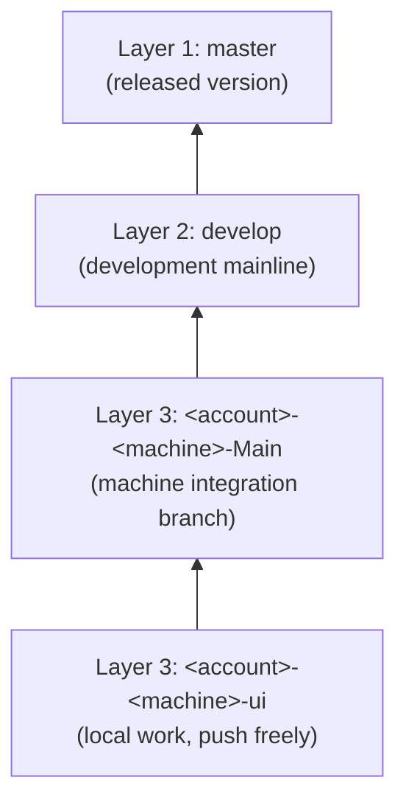

# AI-driven historical sandbox (working title)

> Neither the project nor the repository has a final name yet — the repo still uses the old one and the
> package is called `worldsim`. This page describes **what we are building** and **how far it runs today**,
> not the final architecture.

An AI-driven historical sandbox that keeps running on its own: AI plays characters, NPCs and the people who
push events along, so an era moves forward through thousands of small decisions. A second layer, grounded in
real theory, watches how rumours travel, how opinion drifts and where money flows.

## What runs today

The minimal viable skeleton (T-031) is in place: multiple agents talking to each other, each with its own
background, memory and numeric state, every instance owning a queue so messages never interleave.

| Capability | Status |
| --- | --- |
| An AI character as a standalone instance (background / values / memory) | ✅ done |
| Agent-to-agent messages that both sides remember, plus a growing opinion of each other | ✅ done |
| Manager keyed by name (`dict[name, Agent]`), concurrent add/remove behind a lock | ✅ done |
| One queue + one worker per instance, so a character never handles two messages at once | ✅ done (asserted in tests) |
| World events land straight in memory (nobody "said" them) | ✅ done |
| Trend layer (rumour spread / opinion) | 🚧 DeGroot placeholder, reach and dispersion only |
| World clock, autonomous actions, persistence | 🚧 not yet, see Roadmap |

## Quick start

Python 3.11+, no third-party dependencies, no network:

```bash
python3 -m unittest discover -s tests -v   # 14 offline tests
python3 -m examples.mvp_demo               # three characters, three rounds
```

What the demo prints (excerpt):

```text
[Round 1][event][world -> 阿禾, 陈砚, 林岚] a notice about the salt tax goes up at the city gate
[Round 1][speech][阿禾 -> 陈砚] salt is about to get expensive, the docks were cleared overnight
[Round 1][speech][陈砚 -> 阿禾] I stopped what I was doing. I remember hearing "a notice about the salt tax"…
                               阿禾 is not the sort to make things up, so I will prepare accordingly.

【陈砚】background: a schoolteacher, well informed but careful
  values: trust=66, stress=45, silver=54
  opinion of others:
    - 阿禾: last said "salt is about to get expensive…" (2 exchanges)
```

(The demo itself speaks Chinese; the transcript above is translated for readability.)

## Design

### Four abstractions

| Type | Responsibility |
| --- | --- |
| `Message` | one exchange: sender, recipients, content, topic, credibility, stance |
| `MemoryStore` | one character's own memories plus an opinion record per person |
| `Agent` | an instantiable character: read-only background, 0–100 values, private memory, own queue and worker |
| `AgentManager` | the `dict[name, Agent]` registry, routing, rounds, world events, snapshots |

### What one message actually does

```text
阿禾 send("salt is about to get expensive", to="陈砚")
  ├─ manager: validates both sides, appends to the world log, feeds the trend model
  ├─ 阿禾's memory: "I told 陈砚: salt is about to get expensive"
  ├─ 陈砚's queue: one Message enqueued
  └─ 陈砚's worker (serial):
        1. asks the model first (it cannot see this message yet, so it will not parrot it back)
        2. writes the memory: "阿禾: salt is about to get expensive"
        3. updates the impression of 阿禾 (exchanges +1)
        4. applies value deltas, clamped to 0–100
        5. replies if needed, depth +1 (one hop by default)
```

### Why one queue per instance

- a single global queue would interleave A's two sentences with B's whole conversation;
- per-instance queues guarantee each character writes memories in the order it heard them,
  and one stuck character cannot stall the others;
- the registry is guarded by `asyncio.Lock`, delivery is `put_nowait`, so nobody waits on anybody long enough to deadlock.

The test suite proves it with `_SlowAgent`: six concurrent deliveries, peak concurrency stays at 1, order preserved.

### Values and trends

- every character defines its own `values` (trust / stress / silver / reputation …), 0–100, moved by messages;
- `social.py` runs a DeGroot weighted average (weight = trust × credibility) and reports reach, mean stance
  and dispersion per topic — a **placeholder** for the trend layer; the interface stays when a real
  opinion / finance model arrives.

### Layout

```text
worldsim/
  message.py   the message model
  memory.py    memories: episodes, opinions, recall
  agent.py     the character instance
  manager.py   registry and routing
  llm.py       offline heuristic / scripted / OpenAI-compatible
  social.py    trend placeholder (DeGroot)
examples/mvp_demo.py   runnable demo
tests/test_worldsim.py offline tests
docs/worldsim-mvp.md   design notes and the mapping to Ayaka V2.5
```

## Using a real model

The default is an offline heuristic model so tests and the demo are reproducible. To use a real one, point it
at any OpenAI-compatible endpoint (DeepSeek, Qwen, a local vLLM):

```bash
export WORLDSIM_API_KEY=sk-...
export WORLDSIM_BASE_URL=https://api.deepseek.com/v1
export WORLDSIM_MODEL=deepseek-chat
python3 -m examples.mvp_demo --online
```

Without a key, `--online` falls back to the offline model instead of crashing.

## Relationship to Ayaka V2.5

The skeleton borrows from `ProjectAyaka/Digital Life_Ayaka-V2.5`'s `WorldEngine` / `AIThread` /
`MemorySystem`: numeric status, per-user memory, and strictly serial processing all survive.
What changes: "one AI + a flag" becomes "many instances + one queue each", and the vector store becomes
reproducible keyword recall. The point-by-point mapping lives in [docs/worldsim-mvp.md](docs/worldsim-mvp.md).

## Roadmap

1. **World clock** — rounds become dates, hours and scheduled events;
2. **Autonomous actions** — port `ListAction / RunTask` so characters can initiate, not only reply;
3. **Persistence** — `Agent.snapshot()` exists, saving and restoring do not;
4. **Real retrieval** — embeddings instead of keyword overlap, with importance and forgetting;
5. **Trend models** — replace the DeGroot placeholder with grounded opinion / finance models;
6. **Observability** — event log and replay, so we can explain why an era went the way it did.

## How to use this repository (read this first)

The repo is not only about the app; it is also a sample of how the work is kept. There are exactly three
branch layers, and changes only flow **upwards**:

| Layer | Branch | What it is |
| --- | --- | --- |
| 1 | `master` | **Released version** — always ready to ship |
| 2 | `develop` | **Development mainline** — where every developer converges |
| 3 | `<account>-<machine>-<suffix>` | **Your account's own branch** — push any time, isolated from others; each account only pushes its own prefix |



1. **Work in layer 3**: name branches `<account>-<machine>-<suffix>`, e.g. `inotfrk-Fairy-ui`.
   The account segment is the **GitHub username** (lowercase, and it owns the branch); the machine segment is
   the local `hostname` with spaces and illegal characters stripped; the suffix is yours; each machine's base
   branch always uses the `Main` suffix. See [.agents/branch-registry.md](.agents/branch-registry.md).
2. **Merge back into the local `-Main`** when a sub-branch is done; `-Main` is that machine's integration branch.
3. **Move `-Main` into `develop`** once a batch is ready — the single convergence point for all developers.
   Open a pull request (base `develop`, compare your `-Main`) and merge it; **you cannot push `develop` directly**.
   Push only content from your own account; on cross-account or mainline conflicts, never force push —
   keep the working state and **raise an OA**.
4. **`develop` promotes itself into `master`**: run `scripts\release.ps1` (macOS / Linux: `scripts/release.sh`),
   which runs the tests, opens a pull request, merges it and tags `v<date>`. [.github/workflows/release.yml](.github/workflows/release.yml)
   does the same automatically on every `develop` push.
5. **Onboard a new member**: invite as a GitHub collaborator → run `scripts\github-rulesets.ps1` to add the
   `<username>-*` rule → update [.agents/branch-registry.md](.agents/branch-registry.md).
6. **One backlog**: [TODO.md](TODO.md). Idle / overnight agents claim `queued` tasks following its
   protocol and commit the status change on its own first, so two agents never grab the same task.
7. **Self-check before promoting**: run `python3 -m unittest discover -s tests` (offline, no key), then check
   Markdown links and `TODO.md` status — see [AGENTS.md](AGENTS.md) section 4.

Neither `master` nor `develop` takes direct pushes: both require a pull request. `develop` only takes
layer-3 pull requests, `master` only takes `develop` pull requests opened by the release script / workflow.
Only layer-3 `<account>-*` branches can be pushed directly, and only within your own account segment.

Full rules are in [AGENTS.md](AGENTS.md) (loaded on every conversation); agent notes are in [NOTE.md](NOTE.md).

## Contribution

1. Fork the repository
2. Branch off the local `-Main` as `<account>-<machine>-<suffix>`
3. Commit with tests passing (`python3 -m unittest discover -s tests`), then merge back into `-Main`
4. Open a pull request against `develop`; `master` is promoted automatically

The branch rules are created and maintained by [scripts/github-rulesets.ps1](scripts/github-rulesets.ps1):
one `<prefix>-owner-only` rule per account segment, plus PR-only rules on `master` and `develop`.
