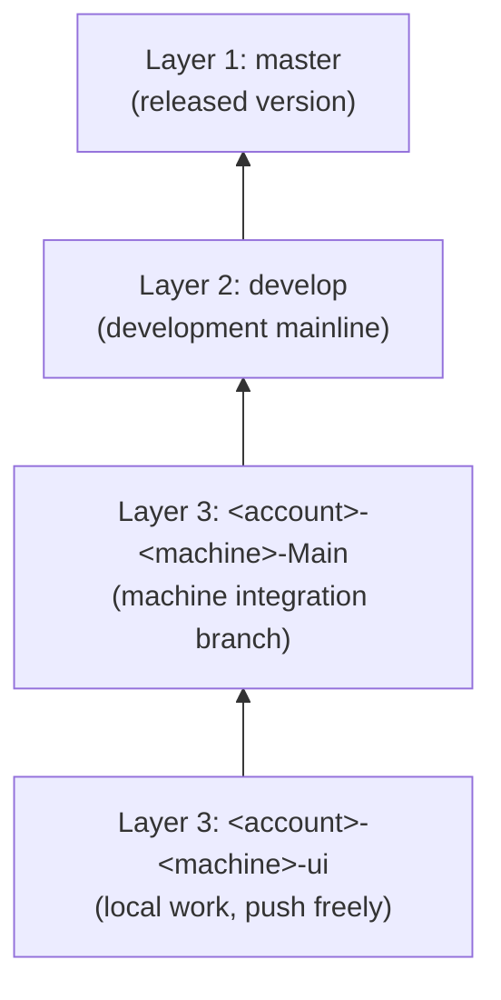

# In this life I have infinite tokens.

A cross-platform calculator written in **C++17**: the whole program lives in a single source file,
with **no third-party dependencies** and no build system beyond one compiler command. The repository
doubles as a sample of how a small project is kept with branches, a task queue and agent collaboration —
read this page and you know how the repo is meant to be used.

#### Features

- Full expression evaluation with `+ - * / % ^`, parentheses, decimals and unary signs
- Right-associative power: `2^3^2 = 512`
- Commands: type an expression and press Enter to evaluate, `clear`, `del`, `copy` (print last result), `recall`
- Operators typed after a result continue from that result
- Chinese error messages for divide-by-zero and mismatched parentheses
- Single file, no global state: `std::string` slices plus a recursive-descent parser

#### Software Architecture

```
calculator.cpp        The single-file sample once ported: parser + REPL (planned)
scripts/
    build.ps1         Windows build script (build / test / run / jar / package / clean)
    build.sh          macOS / Linux build script
src/                  Earlier Java implementation (historical sample, still built by scripts/)
```

The single-file layout is just a handful of functions, read top to bottom:

```cpp
// calculator.cpp — structure sketch
double parseExpression();   // top level: + and -
double parseTerm();         // * / %
double parsePower();        // ^, right-associative
double parseUnary();        // unary +/-
double parsePrimary();      // numbers and parentheses
```

> **Current state:** the implementation that actually runs and is covered by `scripts/` is still the
> earlier Java one under `src/main/java`. The C++ single-file form is the target; `calculator.cpp` is not
> in the repository yet and the port is queued in [TODO.md](TODO.md). Steps marked "C++ sample" below
> work once the port lands.

#### Installation

**Default sandbox (recommended, Docker)**: no JDK on the host; build and test run inside the container.
Install notes and pitfalls: [docs/docker-sandbox-install.md](docs/docker-sandbox-install.md).

```powershell
powershell -ExecutionPolicy Bypass -File scripts\sandbox.ps1 build
powershell -ExecutionPolicy Bypass -File scripts\sandbox.ps1 test
```

On macOS / Linux use `scripts/sandbox.sh build` and `scripts/sandbox.sh test`.
The container stays alive and every run is recorded under `.sandbox-runs/`, so a failure can be
inspected after the fact. Details in [docs/docker-sandbox.md](docs/docker-sandbox.md).

**C++ sample** (available after the port): only a C++17 compiler is needed (MSVC or MinGW-w64 `g++` on
Windows, `clang++` or `g++` on macOS / Linux). No libraries to install.

1. `g++ --version` (Windows: `cl` / `clang++` also work)
2. Clone the repository
3. `g++ -std=c++17 -O2 calculator.cpp -o calculator`

**Existing Java implementation** (the one `scripts/` covers): requires **JDK 21 or newer**
(a full JDK — a JRE has no `javac`, `jar` or `jpackage`).

1. `java -version`
2. `scripts\build.ps1 -Task build` (macOS / Linux: `scripts/build.sh build`)

#### Instructions

| Action | Windows | macOS / Linux |
| --- | --- | --- |
| Run the C++ sample (after compiling) | `calculator.exe` | `./calculator` |
| Run the Java UI | `scripts\build.ps1 -Task run` | `scripts/build.sh run` |
| Run all tests | `scripts\build.ps1 -Task test` | `scripts/build.sh test` |
| Build runnable jar | `scripts\build.ps1 -Task jar` → `dist\Calculator.jar` | `scripts/build.sh jar` |
| Build installer | `scripts\build.ps1 -Task package` | `scripts/build.sh package` |
| Clean | `scripts\build.ps1 -Task clean` | `scripts/build.sh clean` |

Packaging notes:

- **Windows**: one run produces both
  - `dist\Calculator\Calculator.exe` — portable app, no install needed; zipped into
    `dist\Calculator-<version>-windows-x64-portable.zip`
  - `dist\Calculator-<version>.msi` — installer, requires [WiX Toolset 3](https://wixtoolset.org/)
    on `PATH`. Without WiX only the msi step is skipped; the portable build still succeeds
- **macOS**: one run produces `dist/Calculator.app` (portable) and `dist/Calculator-<version>.dmg`
- **Version**: `-Task package -Version 1.2.0` (Windows) or `APP_VERSION=1.2.0 scripts/build.sh package`

Cross-platform packaging runs on GitHub Actions: [.github/workflows/package.yml](.github/workflows/package.yml)
tests on all three platforms and uploads the macOS `dmg` plus the Windows `zip` / `msi` as artifacts.
The repository now lives on GitHub (`Inotfrk/in-this-life-i-have-infinite-tokens`), so a push triggers the
workflow without any manual switch-on. Build installers locally with `scripts\build.ps1 -Task package` or
`scripts/build.sh package`.

You can also run the jar directly: `java -jar dist\Calculator.jar`.

#### How to use this repository (read this first)

The point of the repo is not only the calculator but the workflow it demonstrates. There are exactly three
branch layers, and changes only flow **upwards**:

| Layer | Branch | What it is |
| --- | --- | --- |
| 1 | `master` | **Released version** — always ready to ship |
| 2 | `develop` | **Development mainline** — where every developer converges |
| 3 | `<account>-<machine>-<suffix>` | **Your account's own branch** — push any time, isolated from others; each account only pushes its own prefix |



1. **Work in layer 3**: name branches `<account>-<machine>-<suffix>`, e.g. `inotfrk-Fairy-ui`.
   The account segment is the **GitHub username** (lowercase, and it owns the branch); the machine segment is
   the local `hostname` with spaces and illegal characters stripped; the suffix is yours; each machine's base
   branch always uses the `Main` suffix. See [.agents/branch-registry.md](.agents/branch-registry.md).
2. **Merge back into the local `-Main`** when a sub-branch is done; `-Main` is that machine's integration branch.
3. **Move `-Main` into `develop`** once a batch is ready — the single convergence point for all developers.
   Open a pull request (base `develop`, compare your `-Main`) and merge it; **you cannot push `develop` directly**.
   Push only content from your own account; on cross-account or mainline conflicts, never force push —
   keep the working state and **raise an OA**.
4. **`develop` promotes itself into `master`**: run `scripts\release.ps1` (macOS / Linux: `scripts/release.sh`),
   which runs the tests, opens a pull request, merges it and tags `v<date>`. [.github/workflows/release.yml](.github/workflows/release.yml)
   does the same automatically on every `develop` push.
5. **Onboard a new member**: invite as a GitHub collaborator → run `scripts\github-rulesets.ps1` to add the
   `<username>-*` rule → update [.agents/branch-registry.md](.agents/branch-registry.md).
6. **One backlog**: [TODO.md](TODO.md). Idle / overnight agents claim `queued` tasks following its
   protocol and commit the status change on its own first, so two agents never grab the same task.
7. **Verify before promoting**: `scripts\build.ps1 -Task test` (macOS / Linux: `scripts/build.sh test`).

Neither `master` nor `develop` takes direct pushes: both require a pull request. `develop` only takes
layer-3 pull requests, `master` only takes `develop` pull requests opened by the release script / workflow.
Only layer-3 `<account>-*` branches can be pushed directly, and only within your own account segment.

Full rules are in [AGENTS.md](AGENTS.md) (loaded on every conversation); agent notes are in [NOTE.md](NOTE.md).

#### Contribution

1. Fork the repository
2. Branch off the local `-Main` as `<account>-<machine>-<suffix>`
3. Commit with tests passing, then merge back into `-Main`
4. Open a pull request against `develop`; `master` is promoted automatically
