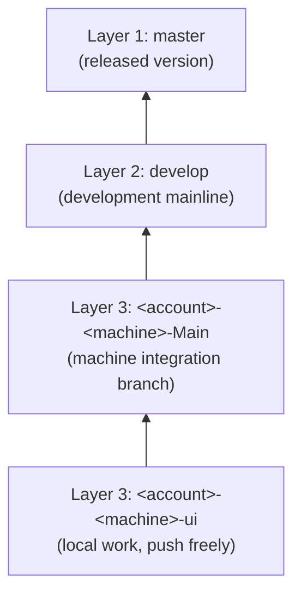

# In this life I have infinite tokens.

> **Repository state: collaboration rules and design documents only.**
> The previous implementation — the C++/Qt UI (`src/`), the Node user-center backend (`server/`) and the
> top-level `CMakeLists.txt` — was cleared on 2026-11-18; the old code stays in the git history and can be
> inspected by commit SHA whenever needed.
>
> What stays: the **rules** (`AGENTS.md`, `.agents/`, the agent definitions and workflows under `.github/`,
> and the release scripts in `scripts/`) plus the **documents those rules reference** (`docs/`,
> `TODO.md`, `NOTE.md`). The documents stay because `.github/agents/project-designer.agent.md` treats
> `docs/software-guide.md` and friends as its editing targets — deleting them would leave the agent rules
> pointing at nothing.
>
> - Full rules: [AGENTS.md](AGENTS.md) (loaded on every conversation)
> - Backlog: [TODO.md](TODO.md) (the only list)
> - Agent notes: [NOTE.md](NOTE.md) (append only)
> - Branch registry: [.agents/branch-registry.md](.agents/branch-registry.md)
> - Verification policy: [AGENTS.md](AGENTS.md) section 4 (no code to test right now; build scripts, Dockerfile,
>   `.devcontainer/`, the sandbox scripts and `package.yml` were removed together with the implementation)

#### How to use this repository (read this first)

The point of the repo is not only the app but the workflow it demonstrates. There are exactly three
branch layers, and changes only flow **upwards**:

| Layer | Branch | What it is |
| --- | --- | --- |
| 1 | `master` | **Released version** — always ready to ship |
| 2 | `develop` | **Development mainline** — where every developer converges |
| 3 | `<account>-<machine>-<suffix>` | **Your account's own branch** — push any time, isolated from others; each account only pushes its own prefix |

1. **Work in layer 3**: name branches `<account>-<machine>-<suffix>`, e.g. `inotfrk-Fairy-ui`.
   The account segment is the **GitHub username** (lowercase, and it owns the branch); the machine segment is
   the local `hostname` with spaces and illegal characters stripped; the suffix is yours; each machine's base
   branch always uses the `Main` suffix. See [.agents/branch-registry.md](.agents/branch-registry.md).
2. **Merge back into the local `-Main`** when a sub-branch is done; `-Main` is that machine's integration branch.
3. **Move `-Main` into `develop`** once a batch is ready — the single convergence point for all developers.
   Open a pull request (base `develop`, compare your `-Main`) and merge it; **you cannot push `develop` directly**.
   Push only content from your own account; on cross-account or mainline conflicts, never force push —
   keep the working state and **raise an OA**.
4. **`develop` promotes itself into `master`**: run `scripts\release.ps1` (macOS / Linux: `scripts/release.sh`),
   which runs the tests, opens a pull request, merges it and tags `v<date>`. [.github/workflows/release.yml](.github/workflows/release.yml)
   does the same automatically on every `develop` push.
5. **Onboard a new member**: invite as a GitHub collaborator → run `scripts\github-rulesets.ps1` to add the
   `<username>-*` rule → update [.agents/branch-registry.md](.agents/branch-registry.md).
6. **One backlog**: [TODO.md](TODO.md). Idle / overnight agents claim `queued` tasks following its
   protocol and commit the status change on its own first, so two agents never grab the same task.
7. **Self-check before promoting**: there is no code to test right now (the implementation was cleared).
   Check Markdown links, command examples and `TODO.md` status instead — see [AGENTS.md](AGENTS.md) section 4.
   When a new implementation lands, restore the build / sandbox / CI pipeline together with it.

Neither `master` nor `develop` takes direct pushes: both require a pull request. `develop` only takes
layer-3 pull requests, `master` only takes `develop` pull requests opened by the release script / workflow.
Only layer-3 `<account>-*` branches can be pushed directly, and only within your own account segment.

Full rules are in [AGENTS.md](AGENTS.md) (loaded on every conversation); agent notes are in [NOTE.md](NOTE.md).

#### Contribution

1. Fork the repository
2. Branch off the local `-Main` as `<account>-<machine>-<suffix>`
3. Commit with tests passing, then merge back into `-Main`
4. Open a pull request against `develop`; `master` is promoted automatically
