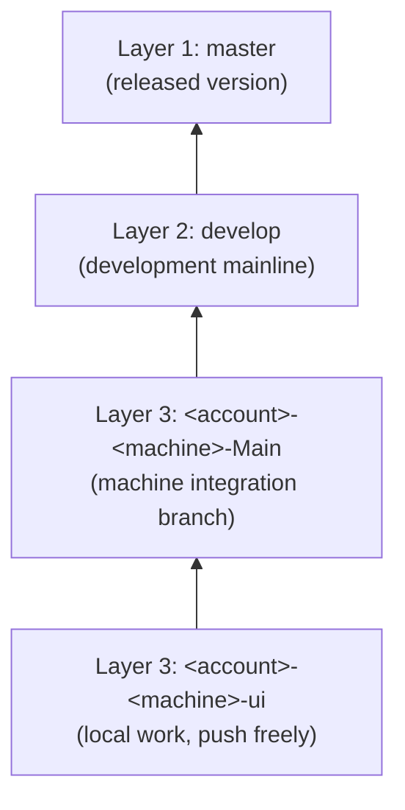

# In this life I have infinite tokens.

A cross-platform **study assistant** desktop app written in **C++17 + Qt 6 (Qt Quick/QML)**, targeting
Windows, macOS and Linux, with iPadOS and Android later. Throw any learning material at it, sort it by
subject, and let AI act on your behalf. The repository doubles as a sample of how a small project is kept
with branches, a task queue and agent collaboration — read this page and you know how the repo is meant
to be used.

> **Current state:** **page-skeleton phase**. The main page already runs in Qt 6
> (`src/ui/qml/Main.qml`), but there is **no functionality yet**: no file loading, no AI calls, no API-key
> storage. The UI design is described in [docs/design-study-app-ui.md](docs/design-study-app-ui.md) and the
> roadmap lives in [TODO.md](TODO.md).

#### Features

Only the UI skeleton exists so far; no behaviour is wired up:

- Left global icon rail (search / note tools / home / collaboration / settings), current page highlighted
- Card header: `☰` more options on the left, an **AI** entry point on the right (its look will be
  configurable in settings)
- Subject sidebar hard-coded to `math` / `phy` / `che`; selects highlight, the list scrolls on its own
- Main content area deliberately empty, reserved for the document reader
- A reserved area at the bottom of the sidebar (purpose undecided)

> The visual style follows GitHub, but that is the **author's personal preference**, not a repository
> standard — nobody else has to copy it. The earlier Java Swing calculator design
> ([docs/design-cpp-qt.md](docs/design-cpp-qt.md)) was retired together with its implementation.

#### Software Architecture

```
src/
    ui/                 QML UI
        main.cpp                Entry point (includes a --screenshot headless switch)
        qml/
            Main.qml            Main page skeleton
            GlyphIcon.qml      Canvas-drawn line icons (no system icon font needed)
            Theme.js            Colours and spacing scale
CMakeLists.txt         Top-level CMake project (Qt 6 + Qt Quick)
scripts/
    build.ps1           Windows build / UI check
    build.sh            macOS / Linux build / UI check
    sandbox.ps1         Long-lived Docker sandbox (Windows)
    sandbox.sh          Long-lived Docker sandbox (macOS / Linux)
    desktop.sh          Xvfb + noVNC inside the container, view the UI in a browser
docs/design-study-app-ui.md  Main page design notes
docs/server-plan.md          Backend plan (accounts / sync / remote config, not implemented)
```

#### Installation

Requires **Qt 6** (6.5 LTS or newer recommended), a C++17 compiler (MSVC / MinGW-w64 / clang++ / g++)
and **CMake 3.21+**.

```powershell
cmake -B build -DCMAKE_BUILD_TYPE=Release -DCMAKE_PREFIX_PATH=D:\Qt\6.8.1\msvc2022_64
cmake --build build --config Release
```

macOS / Linux:

```bash
cmake -S . -B build -G Ninja -DCMAKE_BUILD_TYPE=Release
cmake --build build --parallel
```

To avoid installing Qt locally, use the Docker sandbox (see [docs/docker-sandbox.md](docs/docker-sandbox.md)):

```powershell
powershell -ExecutionPolicy Bypass -File scripts\sandbox.ps1 build
powershell -ExecutionPolicy Bypass -File scripts\sandbox.ps1 view   # view the UI in a browser
```

#### Instructions (available now)

| Action | Notes |
| --- | --- |
| Run the desktop app | Build output `infinite-tokens` (`infinite-tokens.exe` on Windows) |
| Headless UI screenshot | `infinite-tokens --screenshot out.png`, works in containers / CI |
| Build + UI check | `scripts\build.ps1 -Task test` (macOS / Linux: `scripts/build.sh test`) |

Per-platform packaging (`windeployqt` / `macdeployqt` / AppImage / `androiddeployqt`) is not implemented
yet; see [TODO.md](TODO.md).

#### How to use this repository (read this first)

The point of the repo is not only the app but the workflow it demonstrates. There are exactly three
branch layers, and changes only flow **upwards**:

| Layer | Branch | What it is |
| --- | --- | --- |
| 1 | `master` | **Released version** — always ready to ship |
| 2 | `develop` | **Development mainline** — where every developer converges |
| 3 | `<account>-<machine>-<suffix>` | **Your account's own branch** — push any time, isolated from others; each account only pushes its own prefix |



1. **Work in layer 3**: name branches `<account>-<machine>-<suffix>`, e.g. `inotfrk-Fairy-ui`.
   The account segment is the **GitHub username** (lowercase, and it owns the branch); the machine segment is
   the local `hostname` with spaces and illegal characters stripped; the suffix is yours; each machine's base
   branch always uses the `Main` suffix. See [.agents/branch-registry.md](.agents/branch-registry.md).
2. **Merge back into the local `-Main`** when a sub-branch is done; `-Main` is that machine's integration branch.
3. **Move `-Main` into `develop`** once a batch is ready — the single convergence point for all developers.
   Open a pull request (base `develop`, compare your `-Main`) and merge it; **you cannot push `develop` directly**.
   Push only content from your own account; on cross-account or mainline conflicts, never force push —
   keep the working state and **raise an OA**.
4. **`develop` promotes itself into `master`**: run `scripts\release.ps1` (macOS / Linux: `scripts/release.sh`),
   which runs the tests, opens a pull request, merges it and tags `v<date>`. [.github/workflows/release.yml](.github/workflows/release.yml)
   does the same automatically on every `develop` push.
5. **Onboard a new member**: invite as a GitHub collaborator → run `scripts\github-rulesets.ps1` to add the
   `<username>-*` rule → update [.agents/branch-registry.md](.agents/branch-registry.md).
6. **One backlog**: [TODO.md](TODO.md). Idle / overnight agents claim `queued` tasks following its
   protocol and commit the status change on its own first, so two agents never grab the same task.
7. **Verify before promoting**: `scripts\build.ps1 -Task test` (macOS / Linux: `scripts/build.sh test`).

Neither `master` nor `develop` takes direct pushes: both require a pull request. `develop` only takes
layer-3 pull requests, `master` only takes `develop` pull requests opened by the release script / workflow.
Only layer-3 `<account>-*` branches can be pushed directly, and only within your own account segment.

Full rules are in [AGENTS.md](AGENTS.md) (loaded on every conversation); agent notes are in [NOTE.md](NOTE.md).

#### Contribution

1. Fork the repository
2. Branch off the local `-Main` as `<account>-<machine>-<suffix>`
3. Commit with tests passing, then merge back into `-Main`
4. Open a pull request against `develop`; `master` is promoted automatically
