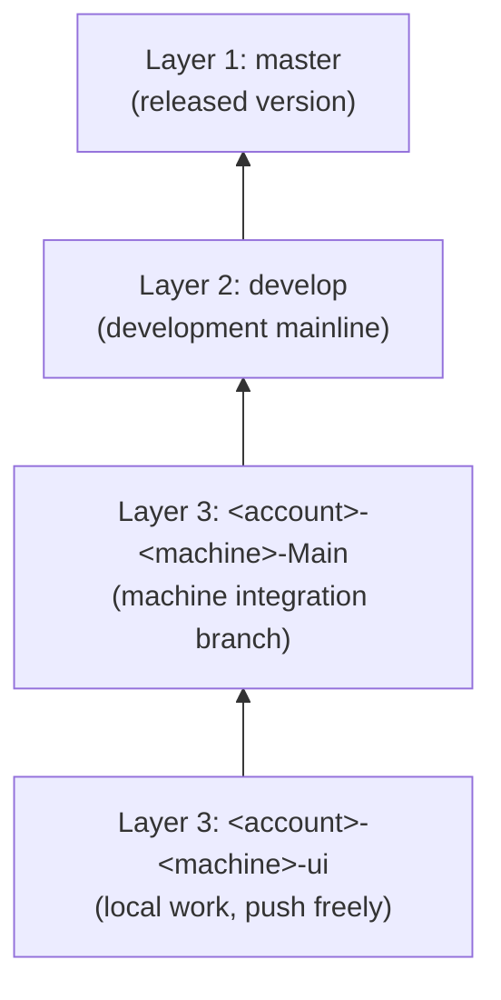

# In this life I have infinite tokens.

A cross-platform calculator written in **C++17 + Qt 6 (Qt Quick/QML)**, targeting Windows, macOS,
Linux, iPadOS and Android. The repository doubles as a sample of how a small project is kept with
branches, a task queue and agent collaboration — read this page and you know how the repo is meant
to be used.

> **Current state:** in the **design phase**. See [docs/design-cpp-qt.md](docs/design-cpp-qt.md) for the
> full design. The earlier Java implementation (`src/main/java`, `src/test/java`) has been removed; the
> C++ / Qt code is not in the repository yet and the implementation is queued in [TODO.md](TODO.md)
> (T-006 ~ T-009).

#### Features

- Full expression evaluation with `+ - * / % ^`, parentheses, decimals and unary signs
- Right-associative power: `2^3^2 = 512`
- Commands: type an expression and press Enter to evaluate, `clear`, `del`, `copy` (print last result), `recall`
- Operators typed after a result continue from that result
- Chinese error messages for divide-by-zero and mismatched parentheses
- Logic layer (pure C++ evaluator) separated from the QML UI; desktop and touch shells

#### Software Architecture

```
src/
    core/               Pure C++ core (no Qt GUI dependency)
        expression_evaluator.*   Recursive-descent evaluator
        calculator_engine.*      Session state (last result, recall)
    ui/                 QML UI
        main.cpp                Entry point
        qml/desktop/            Desktop shell (mouse + keyboard, shortcuts)
        qml/touch/              Touch shell (iPadOS / Android, large buttons + gestures)
CMakeLists.txt         Top-level CMake project (Qt 6)
scripts/
    build.ps1           Windows build script (switches to CMake + Qt in implementation phase)
    build.sh            macOS / Linux build script
docs/design-cpp-qt.md  Design document
```

The core layout is a handful of functions, ported from the earlier Java `ExpressionEvaluator`:

```cpp
// core layer — behaviour identical to the earlier Java implementation
double parseExpression();   // top level: + and -
double parseTerm();         // * / %
double parsePower();        // ^, right-associative
double parseUnary();        // unary +/-
double parsePrimary();      // numbers and parentheses
```

#### Installation (available after implementation)

Requires **Qt 6** (6.5 LTS or newer recommended), a C++17 compiler (MSVC / MinGW-w64 / clang++ / g++)
and **CMake 3.21+**. Building for iPadOS additionally requires macOS + Xcode (Apple requirement).

```powershell
cmake -B build -DCMAKE_BUILD_TYPE=Release
cmake --build build
```

> These commands take effect once the C++ / Qt code lands (T-006 ~ T-008). No directly compilable
> source exists in this phase.

#### Instructions (planned, lands in implementation phase)

| Action | Notes |
| --- | --- |
| Run desktop build | Build output `Calculator` (`Calculator.exe` on Windows) |
| Run touch build | Same QML, adaptive large-button layout on iPadOS / Android |
| Run all tests | Qt Test (matching the 25 cases of the earlier Java `EvaluatorTest`) |

Per-platform packaging (`windeployqt` / `macdeployqt` / `linuxdeployqt` / `androiddeployqt` / Xcode)
is covered in [docs/design-cpp-qt.md](docs/design-cpp-qt.md) §5.

#### How to use this repository (read this first)

The point of the repo is not only the calculator but the workflow it demonstrates. There are exactly three
branch layers, and changes only flow **upwards**:

| Layer | Branch | What it is |
| --- | --- | --- |
| 1 | `master` | **Released version** — always ready to ship |
| 2 | `develop` | **Development mainline** — where every developer converges |
| 3 | `<account>-<machine>-<suffix>` | **Your account's own branch** — push any time, isolated from others; each account only pushes its own prefix |



1. **Work in layer 3**: name branches `<account>-<machine>-<suffix>`, e.g. `inotfrk-Fairy-ui`.
   The account segment is the **GitHub username** (lowercase, and it owns the branch); the machine segment is
   the local `hostname` with spaces and illegal characters stripped; the suffix is yours; each machine's base
   branch always uses the `Main` suffix. See [.agents/branch-registry.md](.agents/branch-registry.md).
2. **Merge back into the local `-Main`** when a sub-branch is done; `-Main` is that machine's integration branch.
3. **Move `-Main` into `develop`** once a batch is ready — the single convergence point for all developers.
   Open a pull request (base `develop`, compare your `-Main`) and merge it; **you cannot push `develop` directly**.
   Push only content from your own account; on cross-account or mainline conflicts, never force push —
   keep the working state and **raise an OA**.
4. **`develop` promotes itself into `master`**: run `scripts\release.ps1` (macOS / Linux: `scripts/release.sh`),
   which runs the tests, opens a pull request, merges it and tags `v<date>`. [.github/workflows/release.yml](.github/workflows/release.yml)
   does the same automatically on every `develop` push.
5. **Onboard a new member**: invite as a GitHub collaborator → run `scripts\github-rulesets.ps1` to add the
   `<username>-*` rule → update [.agents/branch-registry.md](.agents/branch-registry.md).
6. **One backlog**: [TODO.md](TODO.md). Idle / overnight agents claim `queued` tasks following its
   protocol and commit the status change on its own first, so two agents never grab the same task.
7. **Verify before promoting**: `scripts\build.ps1 -Task test` (macOS / Linux: `scripts/build.sh test`).

Neither `master` nor `develop` takes direct pushes: both require a pull request. `develop` only takes
layer-3 pull requests, `master` only takes `develop` pull requests opened by the release script / workflow.
Only layer-3 `<account>-*` branches can be pushed directly, and only within your own account segment.

Full rules are in [AGENTS.md](AGENTS.md) (loaded on every conversation); agent notes are in [NOTE.md](NOTE.md).

#### Contribution

1. Fork the repository
2. Branch off the local `-Main` as `<account>-<machine>-<suffix>`
3. Commit with tests passing, then merge back into `-Main`
4. Open a pull request against `develop`; `master` is promoted automatically
