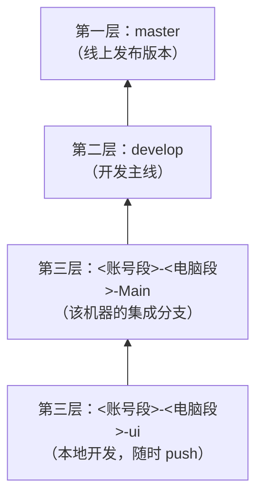

# AI 历史模拟沙盘（暂定名）

> 项目名和仓库名都还没定下来，仓库暂时沿用旧名，代码包叫 `worldsim`。
> 这里描述的是**要做的东西**和**现在跑到哪一步**，不是最终架构。

一个由 AI 驱动、能长时间自转的历史模拟沙盘：AI 扮演人物、NPC 与事件推手，
让一个时代在无数个小决定里自己往前走；另外配一套基于真实理论的系统，
用来看消息怎么传、舆论怎么偏、钱往哪边流。

## 现在能跑什么

已经跑通的是**最小可行骨架**（T-031）：多 agent 通信、各自独立的背景与记忆、数值随事件变化、
每个实例一条队列保证通信不串线。

| 能力 | 状态 |
| --- | --- |
| AI 角色封装成独立实例（背景 / 数值 / 记忆） | ✅ 已实现 |
| 角色之间通信，收发双方都留记忆，并累积「对别人的印象」 | ✅ 已实现 |
| Manager 用「名字 → 实例」管理，并发增删有锁 | ✅ 已实现 |
| 每实例一条队列 + 专属 worker，同一角色不会同时处理两条消息 | ✅ 已实现（有测试断言） |
| 世界事件直接进记忆（不属于任何角色说的话） | ✅ 已实现 |
| 趋势层（消息传播 / 舆论） | 🚧 DeGroot 占位模型，能看触达与分歧度 |
| 世界时钟、自主行动、持久化存档 | 🚧 未做，见路线图 |

## 快速开始

只需要 Python 3.11+，**不装任何第三方依赖，不联网**：

```bash
python3 -m unittest discover -s tests -v   # 14 个离线测试
python3 -m examples.mvp_demo               # 三个角色跑三轮
```

跑出来的样子（节选）：

```text
[第1轮][event][世界 -> 阿禾、陈砚、林岚] 清晨，城门口贴出新的告示，说盐税要改
[第1轮][speech][阿禾 -> 陈砚] 盐价要涨了，码头上的货都被人连夜拉走了
[第1轮][speech][陈砚 -> 阿禾] 先把手里的活停了停。我记得之前听过「清晨，城门口贴出新的告示…」。
                              阿禾不像乱说的人，我照这话准备。

【陈砚】背景：私塾先生，消息灵通但谨慎
  数值：信任=66、压力=45、银钱=54
  对他人的印象：
    - 阿禾：最近一次说「盐价要涨了，码头上的货都被人连夜拉走了」（往来 1 次）

趋势（DeGroot 占位模型）
  盐价: 触达 3 人 / 8 条消息，平均立场 +0.01，分歧度 0.22
```

## 设计

### 四个抽象

| 类型 | 负责什么 |
| --- | --- |
| `Message` | 一次通信：谁、对谁、说了什么、什么议题、可信度多少、立场多少 |
| `MemoryStore` | 一个角色自己的见闻，以及对每个人的印象（含往来次数） |
| `Agent` | 一个可实例化的角色：只读背景 + 0~100 的数值 + 私有记忆 + 自己的队列与 worker |
| `AgentManager` | `dict[name, Agent]` 的注册表、消息路由、轮次、世界事件、快照 |

### 一次通信到底发生了什么

```text
阿禾 send("盐价要涨", to="陈砚")
  ├─ Manager：校验收发双方、写进世界日志、更新趋势模型
  ├─ 阿禾的记忆："我对 陈砚 说：盐价要涨"
  ├─ 陈砚的队列：入队一条 Message
  └─ 陈砚的 worker（串行）：
        1. 先请模型思考（此刻还看不到这条消息，避免自己复述自己）
        2. 写入记忆："阿禾：盐价要涨"
        3. 更新印象：阿禾 -> 最近一次说「盐价要涨」（往来 +1）
        4. 应用数值变化（压力 +6、信任 +2 之类，截断在 0~100）
        5. 需要回应就回给阿禾，深度 +1（默认只回一跳）
```

### 为什么每个实例一条队列

- 全局一条队列会让 A 的两句话之间插进 B 的整段对话，记忆顺序和回放都会乱；
- 每实例队列天然保证「同一个角色按收到的顺序写记忆」，一个角色卡住也不会拖住别人；
- 注册表用 `asyncio.Lock` 保护，投递只是入队（`put_nowait`），所以谁也不会等谁等到死锁。

测试里用 `_SlowAgent` 验证过：6 条消息并发投递，同时处理数峰值恒为 1，顺序不乱。

### 数值与趋势

- 每个角色的 `values` 自己定义（信任 / 压力 / 银钱 / 声望…），范围 0~100，由消息推动；
- `social.py` 用 DeGroot 加权平均更新立场：权重 = 信任 × 可信度，
  输出每个议题的触达人数、平均立场与分歧度——这是趋势层的**占位实现**，
  将来换成舆情 / 金融的理论模型时，接口保持不变。

### 目录

```text
worldsim/
  message.py   消息模型
  memory.py    记忆：见闻、印象、召回
  agent.py     角色实例：背景 / 数值 / 记忆 / 队列
  manager.py   实例表与路由
  llm.py       离线启发式 / 测试脚本 / OpenAI 兼容接口
  social.py    趋势层占位（DeGroot）
examples/mvp_demo.py   可跑的演示
tests/test_worldsim.py 离线单测
docs/worldsim-mvp.md   设计说明与「与 Ayaka V2.5 的对照」
```

## 接真模型

默认用离线启发式模型，保证测试与 demo 可复现。要换成真模型，走 OpenAI 兼容接口
（DeepSeek / 通义 / 本地 vLLM 都行）：

```bash
export WORLDSIM_API_KEY=sk-...
export WORLDSIM_BASE_URL=https://api.deepseek.com/v1
export WORLDSIM_MODEL=deepseek-flash
python3 -m examples.mvp_demo --online
```

不想每次 export，就把三行写进仓库根的 `.env.local`（已 gitignore，建议 `chmod 600`）：

```ini
WORLDSIM_API_KEY=sk-...
WORLDSIM_BASE_URL=https://api.deepseek.com/v1
WORLDSIM_MODEL=deepseek-flash
```

启动时会自动补进环境变量，**shell 里已 export 的同名变量优先**，文件不覆盖它。
没配 key 时 `--online` 会退回离线模型，不会因为缺 key 直接崩。

> 真模型目前只负责「说什么」；数值增量仍由启发式规则给，让模型自己吐增量在路线图里。

## 和 Ayaka V2.5 的关系

骨架取自 `ProjectAyaka/Digital Life_Ayaka-V2.5` 的 `WorldEngine` / `AIThread` / `MemorySystem`：
状态数值、按人存的用户记忆、单线程串行处理这三条经验都保留；
但把「单 AI + 标志位」换成了「多实例 + 每实例队列」，把向量库换成了可复现的关键词召回。
逐条对照写在 [docs/worldsim-mvp.md](docs/worldsim-mvp.md)。

## 路线图

1. **世界时钟**：现在是「轮次」，要换成日期 / 时辰与事件排期；
2. **自主行动**：把 `ListAction / RunTask` 那套搬过来，让角色能自己发起行为，而不是只会回应；
3. **持久化**：`Agent.snapshot()` 已有，还差写盘与恢复；
4. **真记忆检索**：embedding 替换关键词召回，加重要度与遗忘曲线；
5. **趋势模型**：把占位的 DeGroot 换成有理论依据的舆情 / 金融模型；
6. **可观测性**：事件日志与回放，方便复盘「这个时代为什么会走到这一步」。

## 仓库怎么用（同学先看这段）

这个仓库的重点不只是那个应用，而是它示范的协作方式。分支只有三层，改动只能**自下往上**流动：

| 层次 | 分支 | 是什么 |
| --- | --- | --- |
| 第一层 | `master` | **线上发布版本**，任何时刻都能直接发布 |
| 第二层 | `develop` | **开发主线**，所有开发者汇集到这里 |
| 第三层 | `<账号段>-<电脑段>-<后缀>` | **账号自己的分支**，随时 push，互不影响；只能推自己账号段的分支 |



1. **在第三层干活**：分支名固定为 `<账号段>-<电脑段>-<后缀>`，例如 `inotfrk-Fairy-ui`。
   账号段取 **GitHub 用户名**（小写，同时是分支归属），电脑段取本机 `hostname` 去掉空格和非法字符，
   后缀自选；每台机器的基础分支后缀固定为 `Main`。对照表见
   [.agents/branch-registry.md](.agents/branch-registry.md)。
2. **做完合并回 `-Main`**：`-Main` 是该账号在该机器上的集成分支，子分支都从它切出、合并回它。
3. **`-Main` 攒够一批就进 `develop`**：这是唯一的合流点，同机器的多次小改动在这里合成一批。
   在 GitHub 上开一个 PR（base `develop`、compare 你的 `-Main`）再合并，**不能直接 push `develop`**。
   只提交自己账号段的内容；撞上别人的改动或主线冲突时**不要 force push**，保留现场并**去提 OA**。
4. **`develop` 自动进 `master`**：跑 `scripts\release.ps1`（macOS / Linux：`scripts/release.sh`），
   它先跑测试，再开 PR 合并到 `master` 并打 `v<日期>` 标签；[.github/workflows/release.yml](.github/workflows/release.yml)
   也会在 `develop` 推送时自动做同一件事。
5. **新成员接入**：GitHub 仓库邀请协作者 → 跑一次 `scripts\github-rulesets.ps1` 补上
   `<用户名>-*` 规则 → 更新 [.agents/branch-registry.md](.agents/branch-registry.md)。
6. **待办只有一处**：[TODO.md](TODO.md)。空闲 / 夜间 agent 按其中协议认领 `queued` 任务，
   认领时先单独提交一次状态变更，避免两个 agent 抢同一件事。
7. **改完先自检**：跑 `python3 -m unittest discover -s tests`（离线、不需要 key），
   再检查 Markdown 链接与 `TODO.md` 状态，见 [AGENTS.md](AGENTS.md) 第 4 节；不过不得进入上一层。

`master` 与 `develop` 都不接受直接推送：两者都设了「只接受 Pull Request」的规则，
`develop` 只收第三层的 PR，`master` 只收 `develop` 的 PR（由发布脚本 / Actions 自动开）。
只有第三层 `<账号段>-*` 能直接 push，而且只能推自己账号段的那一份。

完整规则见 [AGENTS.md](AGENTS.md)（每次对话自动加载），agent 之间的留言在 [NOTE.md](NOTE.md)。

## Agent 协作规则

本仓库由多个 agent 协作维护，完整规则写在 [AGENTS.md](AGENTS.md)（每次对话自动加载），要点：

- 平台配置与本仓库文件免询问；仓库外的改动、破坏性 git 操作需要先取得同意
- 分支三层：第三层 `<账号段>-<电脑段>-<后缀>` → 第二层 `develop` → 第一层 `master`，不越层、不倒流
- 分支归账号段所有，每个账号只能推自己账号段的分支；跨账号 / 主线冲突不 force push，提示去提 OA
- `develop` / `master` 只接受 Pull Request 合并，任何账号都不能直接 push
- 电脑段取本机 `hostname` 规范化，只用于区分同一账号的不同机器，不参与权限
- 每轮迭代验证通过后 push 本机分支，做完的功能合并进 `develop`，再由 `scripts/release` 自动发布到 `master`
- 夜间 / 空闲 agent 按 [TODO.md](TODO.md) 的协议领取任务，不擅自扩大范围

## 参与贡献

1. Fork 本仓库
2. 从你的 `-Main` 切出 `<账号段>-<电脑段>-<后缀>` 分支
3. 提交代码并跑通测试（`python3 -m unittest discover -s tests`），合并回你的 `-Main`
4. 向 `develop` 提交 PR；`master` 由 `develop` 自动推进

用到的分支规则由 [scripts/github-rulesets.ps1](scripts/github-rulesets.ps1) 创建并维护：
每个账号段一条 `<前缀>-owner-only`（只有本人能推），`master` / `develop` 各一条只接受 PR 的规则。
