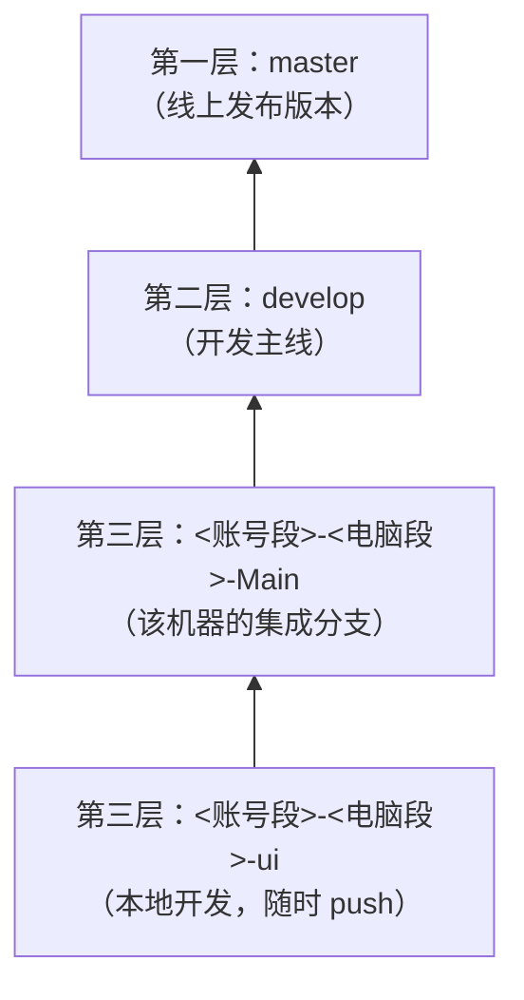

# In this life I have infinite tokens.

一个用 **C++17 + Qt 6（Qt Quick/QML）** 写的跨平台计算器，目标覆盖 Windows、macOS、Linux、
iPadOS 与 Android。这个仓库同时是「一个小项目该怎么用分支、任务队列和 agent 协作来维护」的
样板——看懂这份说明，就明白这个仓库怎么用。

> **当前状态**：处于**设计阶段**。完整设计见 [docs/design-cpp-qt.md](docs/design-cpp-qt.md)。
> 早期的 Java 实现（`src/main/java`、`src/test/java`）已删除，C++ / Qt 代码尚未入库，
> 实现任务按 [TODO.md](TODO.md) 的 T-006~T-009 排队推进。

#### 功能

- 支持 `+ - × ÷ % ^`、括号、小数、一元正负号
- 完整表达式求值（不是逐步运算），乘方右结合：`2^3^2 = 512`
- 交互命令：直接输入表达式回车计算，`clear` 清空、`del` 退格、`copy` 输出上次结果、`recall` 取回上次表达式
- 计算后可直接接运算符，继续用上一次结果计算
- 除零、括号不匹配等错误给出中文提示
- 逻辑层（纯 C++ 求值器）与 UI 层（QML）分离，桌面与触屏两套外壳

#### 软件架构

```
src/
    core/               纯 C++ 核心（无 Qt GUI 依赖）
        expression_evaluator.*   递归下降求值器
        calculator_engine.*      会话状态（上次结果、recall）
    ui/                 QML 界面
        main.cpp               入口
        qml/desktop/           桌面外壳（鼠标键盘 + 快捷键）
        qml/touch/             触屏外壳（iPadOS / Android，大按钮 + 手势）
CMakeLists.txt         顶层 CMake 工程（Qt 6）
scripts/
    build.ps1           Windows 构建脚本（实现阶段切换为 CMake + Qt）
    build.sh            macOS / Linux 构建脚本
docs/design-cpp-qt.md  设计文档
```

核心分层（自顶向下）：

```cpp
// 逻辑层 —— 移植自早期 Java ExpressionEvaluator，行为一致
double parseExpression();   // 顶层：加减
double parseTerm();         // 乘除取模
double parsePower();        // 乘方，右结合
double parseUnary();        // 一元正负号
double parsePrimary();      // 数字与括号
```

#### 安装教程（实现阶段完成后可用）

需要 **Qt 6**（推荐 6.5 LTS 及以上）与一个支持 C++17 的编译器（MSVC / MinGW-w64 / clang++ / g++），
以及 **CMake 3.21+**。iPadOS 构建还需 macOS + Xcode（Apple 硬性要求）。

```powershell
cmake -B build -DCMAKE_BUILD_TYPE=Release
cmake --build build
```

> 上述命令在 C++ / Qt 代码入库（T-006~T-008）后生效。本阶段暂无可直接编译的源码。

#### 使用说明（规划，实现阶段落地）

| 操作 | 说明 |
| --- | --- |
| 运行桌面版 | 构建产物 `Calculator`（Windows 为 `Calculator.exe`） |
| 运行触屏版 | 同一套 QML，在 iPadOS / Android 上自适应大按钮布局 |
| 运行全部测试 | Qt Test（对应早期 Java `EvaluatorTest` 的 25 项） |

各平台打包（`windeployqt` / `macdeployqt` / `linuxdeployqt` / `androiddeployqt` / Xcode）见
[docs/design-cpp-qt.md](docs/design-cpp-qt.md) 第 5 节。

#### 仓库怎么用（同学先看这段）

这个仓库的重点不只是那个计算器，而是它示范的协作方式。分支只有三层，改动只能**自下往上**流动：

| 层次 | 分支 | 是什么 |
| --- | --- | --- |
| 第一层 | `master` | **线上发布版本**，任何时刻都能直接发布 |
| 第二层 | `develop` | **开发主线**，所有开发者汇集到这里 |
| 第三层 | `<账号段>-<电脑段>-<后缀>` | **账号自己的分支**，随时 push，互不影响；只能推自己账号段的分支 |



1. **在第三层干活**：分支名固定为 `<账号段>-<电脑段>-<后缀>`，例如 `inotfrk-Fairy-ui`。
   账号段取 **GitHub 用户名**（小写，同时是分支归属），电脑段取本机 `hostname` 去掉空格和非法字符，
   后缀自选；每台机器的基础分支后缀固定为 `Main`。对照表见
   [.agents/branch-registry.md](.agents/branch-registry.md)。
2. **做完合并回 `-Main`**：`-Main` 是该账号在该机器上的集成分支，子分支都从它切出、合并回它。
3. **`-Main` 攒够一批就进 `develop`**：这是唯一的合流点，同机器的多次小改动在这里合成一批。
   在 GitHub 上开一个 PR（base `develop`、compare 你的 `-Main`）再合并，**不能直接 push `develop`**。
   只提交自己账号段的内容；撞上别人的改动或主线冲突时**不要 force push**，保留现场并**去提 OA**。
4. **`develop` 自动进 `master`**：跑 `scripts\release.ps1`（macOS / Linux：`scripts/release.sh`），
   它先跑测试，再开 PR 合并到 `master` 并打 `v<日期>` 标签；[.github/workflows/release.yml](.github/workflows/release.yml)
   也会在 `develop` 推送时自动做同一件事。
5. **新成员接入**：GitHub 仓库邀请协作者 → 跑一次 `scripts\github-rulesets.ps1` 补上
   `<用户名>-*` 规则 → 更新 [.agents/branch-registry.md](.agents/branch-registry.md)。
6. **待办只有一处**：[TODO.md](TODO.md)。空闲 / 夜间 agent 按其中协议认领 `queued` 任务，
   认领时先单独提交一次状态变更，避免两个 agent 抢同一件事。
7. **改完先验证**：`scripts\build.ps1 -Task test`（macOS / Linux：`scripts/build.sh test`），
   不通过不得进入上一层。

`master` 与 `develop` 都不接受直接推送：两者都设了「只接受 Pull Request」的规则，
`develop` 只收第三层的 PR，`master` 只收 `develop` 的 PR（由发布脚本 / Actions 自动开）。
只有第三层 `<账号段>-*` 能直接 push，而且只能推自己账号段的那一份。

完整规则见 [AGENTS.md](AGENTS.md)（每次对话自动加载），agent 之间的留言在 [NOTE.md](NOTE.md)。

#### Agent 协作规则

本仓库由多个 agent 协作维护，完整规则写在 [AGENTS.md](AGENTS.md)（每次对话自动加载），要点：

- 平台配置与本仓库文件免询问；仓库外的改动、破坏性 git 操作需要先取得同意
- 分支三层：第三层 `<账号段>-<电脑段>-<后缀>` → 第二层 `develop` → 第一层 `master`，不越层、不倒流
- 分支归账号段所有，每个账号只能推自己账号段的分支；跨账号 / 主线冲突不 force push，提示去提 OA
- `develop` / `master` 只接受 Pull Request 合并，任何账号都不能直接 push
- 电脑段取本机 `hostname` 规范化，只用于区分同一账号的不同机器，不参与权限
- 每轮迭代验证通过后 push 本机分支，做完的功能合并进 `develop`，再由 `scripts/release` 自动发布到 `master`
- 夜间 / 空闲 agent 按 [TODO.md](TODO.md) 的协议领取任务，不擅自扩大范围

#### 参与贡献

1. Fork 本仓库
2. 从你的 `-Main` 切出 `<账号段>-<电脑段>-<后缀>` 分支
3. 提交代码并跑通测试，合并回你的 `-Main`
4. 向 `develop` 提交 PR；`master` 由 `develop` 自动推进

用到的分支规则由 [scripts/github-rulesets.ps1](scripts/github-rulesets.ps1) 创建并维护：
每个账号段一条 `<前缀>-owner-only`（只有本人能推），`master` / `develop` 各一条只接受 PR 的规则。
