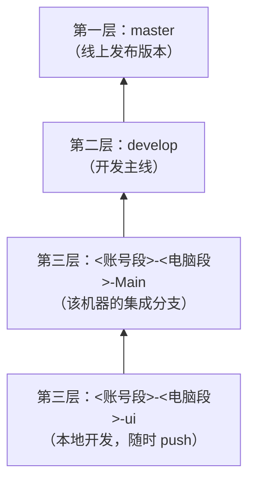

# In this life I have infinite tokens.

> **仓库当前状态：协作规则 + 一个 demo 模块。**
> 上一版原型——AI 历史沙盘 `worldsim`（agent 通信 / 记忆 / 队列）——连同它的设计文档
> `docs/worldsim-mvp.md` 已于 2026-11-25 清空；更早的 C++/Qt 实现、Node 后端、设计稿与截图
> 也已经从工作区移除。所有旧内容都留在 git 历史里，需要时用 `git log --all --oneline` 找到 SHA 再翻。
>
> 现有的模块：
>
> - [apps/pc-builder](apps/pc-builder/README.md)：**3D 装机模拟器 demo**（Electron + Three.js），
>   拖拽装机、按厂商筛选、参数面板、兼容性检查与综合评分。
>
> 剩下的部分只讲「怎么协作」：
>
> - 完整规则：[AGENTS.md](AGENTS.md)（每次对话自动加载）
> - 待办队列：[TODO.md](TODO.md)（唯一清单）
> - agent 留言板：[NOTE.md](NOTE.md)（只追加）
> - 分支对照表：[.agents/branch-registry.md](.agents/branch-registry.md)
> - 远端规则：[scripts/github-rulesets.ps1](scripts/github-rulesets.ps1)（`master` / `develop` 只收 PR，
>   `<账号段>-*` 只许本人推）
>
> `docs/` 目录目前是空的；要写设计文档时按 [.github/agents/project-designer.agent.md](.github/agents/project-designer.agent.md)
> 的约定新建 `docs/software-guide.md`。

## 仓库怎么用（同学先看这段）

分支只有三层，改动只能**自下往上**流动：

| 层次 | 分支 | 是什么 |
| --- | --- | --- |
| 第一层 | `master` | **线上发布版本**，任何时刻都能直接发布 |
| 第二层 | `develop` | **开发主线**，所有开发者汇集到这里 |
| 第三层 | `<账号段>-<电脑段>-<后缀>` | **账号自己的分支**，随时 push，互不影响；只能推自己账号段的分支 |

1. **在第三层干活**：分支名固定为 `<账号段>-<电脑段>-<后缀>`，例如 `inotfrk-Fairy-ui`。
   账号段取 **GitHub 用户名**（小写，同时是分支归属），电脑段取本机 `hostname` 去掉空格和非法字符，
   后缀自选；每台机器的基础分支后缀固定为 `Main`。对照表见
   [.agents/branch-registry.md](.agents/branch-registry.md)。
2. **做完合并回 `-Main`**：`-Main` 是该账号在该机器上的集成分支，子分支都从它切出、合并回它。
3. **`-Main` 攒够一批就进 `develop`**：这是唯一的合流点，同机器的多次小改动在这里合成一批。
   在 GitHub 上开一个 PR（base `develop`、compare 你的 `-Main`）再合并，**不能直接 push `develop`**。
   只提交自己账号段的内容；撞上别人的改动或主线冲突时**不要 force push**，保留现场并**去提 OA**。
4. **`develop` 自动进 `master`**：跑 `scripts\release.ps1`（macOS / Linux：`scripts/release.sh`），
   它先跑测试，再开 PR 合并到 `master` 并打 `v<日期>` 标签；[.github/workflows/release.yml](.github/workflows/release.yml)
   也会在 `develop` 推送时自动做同一件事。
5. **新成员接入**：GitHub 仓库邀请协作者 → 跑一次 `scripts\github-rulesets.ps1` 补上
   `<用户名>-*` 规则 → 更新 [.agents/branch-registry.md](.agents/branch-registry.md)。
6. **待办只有一处**：[TODO.md](TODO.md)。空闲 / 夜间 agent 按其中协议认领 `queued` 任务，
   认领时先单独提交一次状态变更，避免两个 agent 抢同一件事。
7. **改完先自检**：当前没有可测代码，改完只需检查 Markdown 链接与 `TODO.md` 状态，
   见 [AGENTS.md](AGENTS.md) 第 4 节；自检不过不得进入上一层。新实现落地时同时恢复构建 / 沙箱 / CI。

`master` 与 `develop` 都不接受直接推送：两者都设了「只接受 Pull Request」的规则，
`develop` 只收第三层的 PR，`master` 只收 `develop` 的 PR（由发布脚本 / Actions 自动开）。
只有第三层 `<账号段>-*` 能直接 push，而且只能推自己账号段的那一份。

完整规则见 [AGENTS.md](AGENTS.md)（每次对话自动加载），agent 之间的留言在 [NOTE.md](NOTE.md)。

## Agent 协作规则

本仓库由多个 agent 协作维护，完整规则写在 [AGENTS.md](AGENTS.md)（每次对话自动加载），要点：

- 平台配置与本仓库文件免询问；仓库外的改动、破坏性 git 操作需要先取得同意
- 分支三层：第三层 `<账号段>-<电脑段>-<后缀>` → 第二层 `develop` → 第一层 `master`，不越层、不倒流
- 分支归账号段所有，每个账号只能推自己账号段的分支；跨账号 / 主线冲突不 force push，提示去提 OA
- `develop` / `master` 只接受 Pull Request 合并，任何账号都不能直接 push
- 电脑段取本机 `hostname` 规范化，只用于区分同一账号的不同机器，不参与权限
- 每轮迭代验证通过后 push 本机分支，做完的功能合并进 `develop`，再由 `scripts/release` 自动发布到 `master`
- 夜间 / 空闲 agent 按 [TODO.md](TODO.md) 的协议领取任务，不擅自扩大范围

## 参与贡献

1. Fork 本仓库
2. 从你的 `-Main` 切出 `<账号段>-<电脑段>-<后缀>` 分支
3. 提交并自检（Markdown 链接 / TODO 状态），合并回你的 `-Main`
4. 向 `develop` 提交 PR；`master` 由 `develop` 自动推进

用到的分支规则由 [scripts/github-rulesets.ps1](scripts/github-rulesets.ps1) 创建并维护：
每个账号段一条 `<前缀>-owner-only`（只有本人能推），`master` / `develop` 各一条只接受 PR 的规则。
