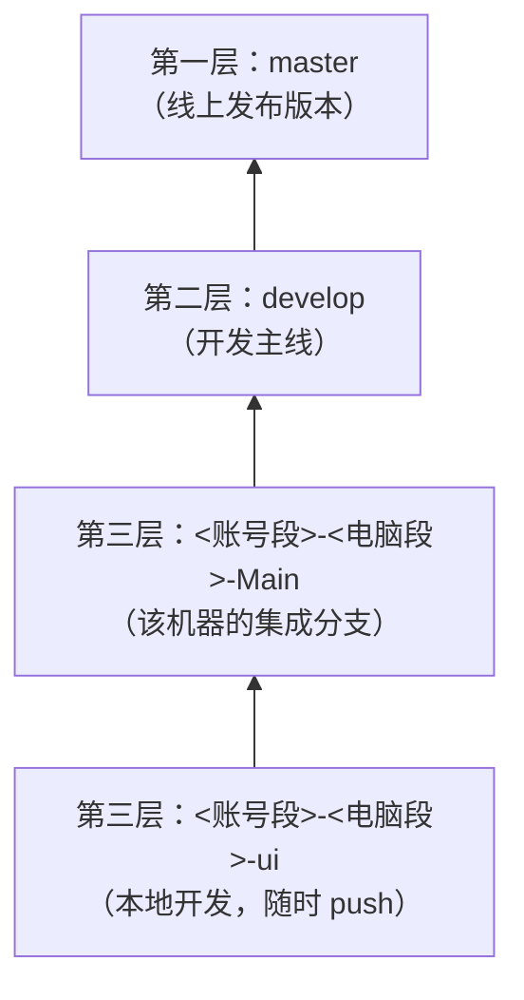

# In this life I have infinite tokens.

一个用 **C++17** 写的跨平台计算器：核心逻辑收在一个源文件里，**零第三方依赖**，
不需要 CMake 之类的构建系统，一条编译命令就能跑起来。这个仓库同时是「一个小项目该怎么用分支、
任务队列和 agent 协作来维护」的样板——看懂这份说明，就明白这个仓库怎么用。

#### 功能

- 支持 `+ - × ÷ % ^`、括号、小数、一元正负号
- 完整表达式求值（不是逐步运算），乘方右结合：`2^3^2 = 512`
- 交互命令：直接输入表达式回车计算，`clear` 清空、`del` 退格、`copy` 输出上次结果、`recall` 取回上次表达式
- 计算后可直接接运算符，继续用上一次结果计算
- 除零、括号不匹配等错误给出中文提示
- 单文件、无全局状态，`std::string` 切片 + 递归下降解析，整个程序可以塞进一个 `.cpp`

#### 软件架构

```
calculator.cpp        单文件示例：递归下降求值器 + 交互循环，整个程序就是这一个文件（规划中）
scripts/
    build.ps1         Windows 构建脚本（build / test / run / jar / package / clean）
    build.sh          macOS / Linux 构建脚本
src/                  早期 Java 实现（历史示例，构建脚本仍可直接编译运行）
```

单文件示例的分层就是几个函数，从上往下读即可：

```cpp
// calculator.cpp —— 结构示意
double parseExpression();   // 顶层：加减
double parseTerm();         // 乘除取模
double parsePower();        // 乘方，右结合
double parseUnary();        // 一元正负号
double parsePrimary();      // 数字与括号
```

> **当前状态**：仓库里目前真正可运行、被 `scripts/` 构建与测试覆盖的仍是早期的 Java 实现
> （`src/main/java`）；C++ 单文件形态是本仓库的目标，`calculator.cpp` 尚未入库，
> 移植工作按 [TODO.md](TODO.md) 排队推进。下面标「C++ 示例」的步骤在移植完成后即可使用。

#### 安装教程

**默认沙箱（推荐，Docker）**：不装 JDK，构建和测试都在容器里跑。
安装器说明、踩坑记录见 [docs/docker-sandbox-install.md](docs/docker-sandbox-install.md)：

```powershell
powershell -ExecutionPolicy Bypass -File scripts\sandbox.ps1 build
powershell -ExecutionPolicy Bypass -File scripts\sandbox.ps1 test
```

macOS / Linux 用 `scripts/sandbox.sh build` 与 `scripts/sandbox.sh test`。
容器常驻、每次运行留档到 `.sandbox-runs/`，失败可回溯现场。容器默认限 `2g` 内存 / 2 CPU
（`--memory-swap` 同步封顶），避免构建异常时把整台机器拖死；可用 `-Memory`、`-Cpus` 调整。
细节见 [docs/docker-sandbox.md](docs/docker-sandbox.md)。

**C++ 示例**（移植完成后可用）：只需要一个支持 C++17 的编译器（Windows 用 MSVC 或 MinGW-w64 的 `g++`，
macOS / Linux 用 `clang++` 或 `g++`），不需要安装任何库。

1. 检查环境：`g++ --version`（Windows 也可用 `cl` / `clang++`）
2. 克隆本仓库
3. 编译：`g++ -std=c++17 -O2 calculator.cpp -o calculator`

**现有 Java 实现**（`scripts/` 覆盖的那一套）：需要 **JDK 21 或更高版本**
（必须是完整 JDK，JRE 里没有 `javac` / `jar` / `jpackage`）。

1. 检查环境：`java -version`
2. 编译：`scripts\build.ps1 -Task build`（macOS / Linux：`scripts/build.sh build`）

#### 使用说明

| 操作 | Windows | macOS / Linux |
| --- | --- | --- |
| 运行 C++ 示例（编译后） | `calculator.exe` | `./calculator` |
| 运行 Java 版界面 | `scripts\build.ps1 -Task run` | `scripts/build.sh run` |
| 运行全部测试 | `scripts\build.ps1 -Task test` | `scripts/build.sh test` |
| 生成可执行 jar | `scripts\build.ps1 -Task jar` → `dist\Calculator.jar` | `scripts/build.sh jar` |
| 打安装包 | `scripts\build.ps1 -Task package` | `scripts/build.sh package` |
| 清理产物 | `scripts\build.ps1 -Task clean` | `scripts/build.sh clean` |

安装包说明：

- **Windows**：一次打包同时产出两个结果
  - `dist\Calculator\Calculator.exe`：免安装绿色版，双击即用；同时压成
    `dist\Calculator-<版本>-windows-x64-portable.zip` 方便分发
  - `dist\Calculator-<版本>.msi`：安装包，需要 [WiX Toolset 3](https://wixtoolset.org/) 在 PATH 上；
    没有 WiX 时只跳过 msi，绿色版照常生成，脚本仍以成功退出
- **macOS**：一次打包产出 `dist/Calculator.app`（便携）与 `dist/Calculator-<版本>.dmg`（安装包）
- **版本号**：`-Task package -Version 1.2.0`（Windows）或 `APP_VERSION=1.2.0 scripts/build.sh package`

打包脚本按平台各跑一次，交给 GitHub Actions 在原生 runner 上执行：

| 平台 | 位置 | 产物 |
| --- | --- | --- |
| GitHub Actions（测试） | [.github/workflows/package.yml](.github/workflows/package.yml) | 三平台跑测试 |
| GitHub Actions（打包） | [.github/workflows/package.yml](.github/workflows/package.yml) | macOS `dmg`、Windows `zip` + `msi`，作为 artifact 上传 |

> 仓库已迁到 GitHub（`Inotfrk/in-this-life-i-have-infinite-tokens`），推送即触发 Actions，
> 不需要手动开启。想在本机出安装包也可以跑 `scripts\build.ps1 -Task package`
> 或 `scripts/build.sh package`。

已生成的 jar 也可以直接用 `java -jar dist\Calculator.jar` 运行。

#### 仓库怎么用（同学先看这段）

这个仓库的重点不只是那个计算器，而是它示范的协作方式。分支只有三层，改动只能**自下往上**流动：

| 层次 | 分支 | 是什么 |
| --- | --- | --- |
| 第一层 | `master` | **线上发布版本**，任何时刻都能直接发布 |
| 第二层 | `develop` | **开发主线**，所有开发者汇集到这里 |
| 第三层 | `<账号段>-<电脑段>-<后缀>` | **账号自己的分支**，随时 push，互不影响；只能推自己账号段的分支 |



1. **在第三层干活**：分支名固定为 `<账号段>-<电脑段>-<后缀>`，例如 `inotfrk-Fairy-ui`。
   账号段取 **GitHub 用户名**（小写，同时是分支归属），电脑段取本机 `hostname` 去掉空格和非法字符，
   后缀自选；每台机器的基础分支后缀固定为 `Main`。对照表见
   [.agents/branch-registry.md](.agents/branch-registry.md)。
2. **做完合并回 `-Main`**：`-Main` 是该账号在该机器上的集成分支，子分支都从它切出、合并回它。
3. **`-Main` 攒够一批就进 `develop`**：这是唯一的合流点，同机器的多次小改动在这里合成一批。
   在 GitHub 上开一个 PR（base `develop`、compare 你的 `-Main`）再合并，**不能直接 push `develop`**。
   只提交自己账号段的内容；撞上别人的改动或主线冲突时**不要 force push**，保留现场并**去提 OA**。
4. **`develop` 自动进 `master`**：跑 `scripts\release.ps1`（macOS / Linux：`scripts/release.sh`），
   它先跑测试，再开 PR 合并到 `master` 并打 `v<日期>` 标签；[.github/workflows/release.yml](.github/workflows/release.yml)
   也会在 `develop` 推送时自动做同一件事。
5. **新成员接入**：GitHub 仓库邀请协作者 → 跑一次 `scripts\github-rulesets.ps1` 补上
   `<用户名>-*` 规则 → 更新 [.agents/branch-registry.md](.agents/branch-registry.md)。
6. **待办只有一处**：[TODO.md](TODO.md)。空闲 / 夜间 agent 按其中协议认领 `queued` 任务，
   认领时先单独提交一次状态变更，避免两个 agent 抢同一件事。
7. **改完先验证**：`scripts\build.ps1 -Task test`（macOS / Linux：`scripts/build.sh test`），
   不通过不得进入上一层。

`master` 与 `develop` 都不接受直接推送：两者都设了「只接受 Pull Request」的规则，
`develop` 只收第三层的 PR，`master` 只收 `develop` 的 PR（由发布脚本 / Actions 自动开）。
只有第三层 `<账号段>-*` 能直接 push，而且只能推自己账号段的那一份。

完整规则见 [AGENTS.md](AGENTS.md)（每次对话自动加载），agent 之间的留言在 [NOTE.md](NOTE.md)。

#### Agent 协作规则

本仓库由多个 agent 协作维护，完整规则写在 [AGENTS.md](AGENTS.md)（每次对话自动加载），要点：

- 平台配置与本仓库文件免询问；仓库外的改动、破坏性 git 操作需要先取得同意
- 分支三层：第三层 `<账号段>-<电脑段>-<后缀>` → 第二层 `develop` → 第一层 `master`，不越层、不倒流
- 分支归账号段所有，每个账号只能推自己账号段的分支；跨账号 / 主线冲突不 force push，提示去提 OA
- `develop` / `master` 只接受 Pull Request 合并，任何账号都不能直接 push
- 电脑段取本机 `hostname` 规范化，只用于区分同一账号的不同机器，不参与权限
- 每轮迭代验证通过后 push 本机分支，做完的功能合并进 `develop`，再由 `scripts/release` 自动发布到 `master`
- 夜间 / 空闲 agent 按 [TODO.md](TODO.md) 的协议领取任务，不擅自扩大范围

#### 参与贡献

1. Fork 本仓库
2. 从你的 `-Main` 切出 `<账号段>-<电脑段>-<后缀>` 分支
3. 提交代码并跑通测试，合并回你的 `-Main`
4. 向 `develop` 提交 PR；`master` 由 `develop` 自动推进

用到的分支规则由 [scripts/github-rulesets.ps1](scripts/github-rulesets.ps1) 创建并维护：
每个账号段一条 `<前缀>-owner-only`（只有本人能推），`master` / `develop` 各一条只接受 PR 的规则。
