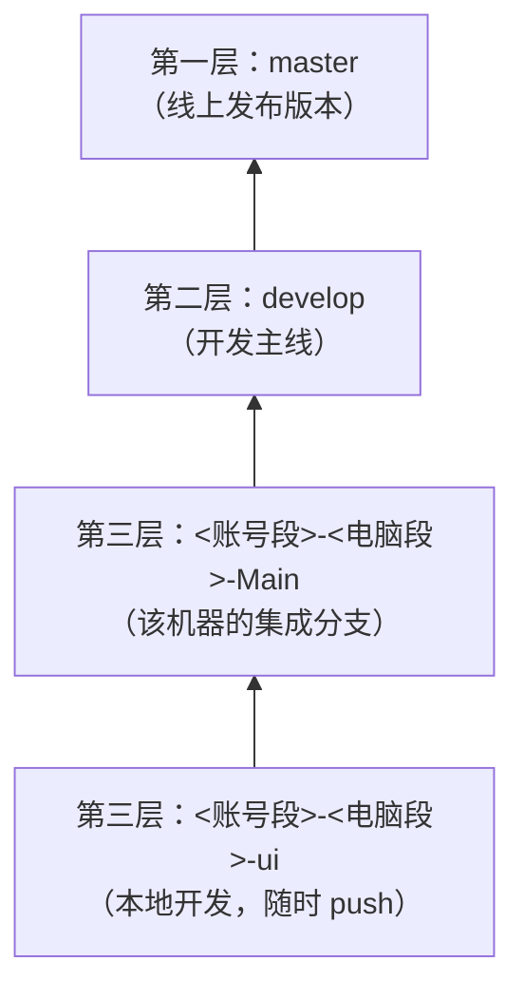

# In this life I have infinite tokens.

一个用 **C++17 + Qt 6（Qt Quick/QML）** 写的跨平台**学习助手**桌面应用，目标覆盖 Windows、macOS、
Linux，以及后续的 iPadOS 与 Android。它可以把你的学习资料统一扔进来、按学科归类，并接 AI 帮你操作。
这个仓库同时是「一个小项目该怎么用分支、任务队列和 agent 协作来维护」的样板——
看懂这份说明，就明白这个仓库怎么用。

> **当前状态**：**页面骨架阶段**。主页面已经能在 Qt 6 里跑起来（`src/ui/qml/Main.qml`），
> 但**没有任何业务功能**：不读文件、不调 AI、不存 API Key。
> 界面设计说明见 [docs/design-study-app-ui.md](docs/design-study-app-ui.md)，
> 后续规划见 [TODO.md](TODO.md)。

#### 功能

现阶段只是界面骨架，实际行为都还没接：

- 左侧全局图标栏（搜索 / 笔记类工具 / 主页 / 协作 / 设置），当前页高亮
- 内容卡片头部：左侧 `☰` 更多选项，右侧 **AI** 入口（外观将来可在设置里更换）
- 学科侧栏写死 `math` / `phy` / `che`，可点选高亮、列表可独立滚动
- 右侧主内容区刻意留空，等后续接入资料阅读
- 侧栏底部预留区（用途未定）

> 界面风格参考了 GitHub，但那是**作者个人偏好**，不是仓库规范，其他人不必照抄。
> 早期那个 Java Swing 计算器的设计（[docs/design-cpp-qt.md](docs/design-cpp-qt.md)）已随实现一并淘汰。

#### 软件架构

```
src/
    ui/                 QML 界面
        main.cpp               入口（含 --screenshot 无头截图开关）
        qml/
            Main.qml           主页面骨架
            GlyphIcon.qml      Canvas 画的线性图标（不依赖系统图标字体）
            Theme.js           配色与间距刻度
CMakeLists.txt         顶层 CMake 工程（Qt 6 + Qt Quick）
scripts/
    build.ps1           Windows 构建 / 界面检查
    build.sh            macOS / Linux 构建 / 界面检查
    sandbox.ps1         长驻 Docker 沙箱（Windows）
    sandbox.sh          长驻 Docker 沙箱（macOS / Linux）
    desktop.sh          容器内起 Xvfb + noVNC，用浏览器看真实界面
docs/design-study-app-ui.md  主页面设计说明
docs/server-plan.md          服务端方案（账号 / 同步 / 配置下发）
server/                      用户中心后端（Node + Express + PostgreSQL，未部署）
```

#### 安装教程

需要 **Qt 6**（推荐 6.5 LTS 及以上）与一个支持 C++17 的编译器（MSVC / MinGW-w64 / clang++ / g++），
以及 **CMake 3.21+**。

```powershell
cmake -B build -DCMAKE_BUILD_TYPE=Release -DCMAKE_PREFIX_PATH=D:\Qt\6.8.1\msvc2022_64
cmake --build build --config Release
```

macOS / Linux：

```bash
cmake -S . -B build -G Ninja -DCMAKE_BUILD_TYPE=Release
cmake --build build --parallel
```

不想在本机装 Qt 时，用 Docker 沙箱（见 [docs/docker-sandbox.md](docs/docker-sandbox.md)）：

```powershell
powershell -ExecutionPolicy Bypass -File scripts\sandbox.ps1 build
powershell -ExecutionPolicy Bypass -File scripts\sandbox.ps1 view   # 浏览器里看界面
```

#### 使用说明（当前可用）

| 操作 | 说明 |
| --- | --- |
| 运行桌面版 | 构建产物 `infinite-tokens`（Windows 为 `infinite-tokens.exe`） |
| 看界面截图（无头） | `infinite-tokens --screenshot out.png`，容器 / CI 里也能出图 |
| 构建 + 界面检查 | `scripts\build.ps1 -Task test`（macOS / Linux：`scripts/build.sh test`） |

各平台打包（`windeployqt` / `macdeployqt` / AppImage / `androiddeployqt`）尚未实现，见 [TODO.md](TODO.md)。

#### 仓库怎么用（同学先看这段）

这个仓库的重点不只是那个应用，而是它示范的协作方式。分支只有三层，改动只能**自下往上**流动：

| 层次 | 分支 | 是什么 |
| --- | --- | --- |
| 第一层 | `master` | **线上发布版本**，任何时刻都能直接发布 |
| 第二层 | `develop` | **开发主线**，所有开发者汇集到这里 |
| 第三层 | `<账号段>-<电脑段>-<后缀>` | **账号自己的分支**，随时 push，互不影响；只能推自己账号段的分支 |



1. **在第三层干活**：分支名固定为 `<账号段>-<电脑段>-<后缀>`，例如 `inotfrk-Fairy-ui`。
   账号段取 **GitHub 用户名**（小写，同时是分支归属），电脑段取本机 `hostname` 去掉空格和非法字符，
   后缀自选；每台机器的基础分支后缀固定为 `Main`。对照表见
   [.agents/branch-registry.md](.agents/branch-registry.md)。
2. **做完合并回 `-Main`**：`-Main` 是该账号在该机器上的集成分支，子分支都从它切出、合并回它。
3. **`-Main` 攒够一批就进 `develop`**：这是唯一的合流点，同机器的多次小改动在这里合成一批。
   在 GitHub 上开一个 PR（base `develop`、compare 你的 `-Main`）再合并，**不能直接 push `develop`**。
   只提交自己账号段的内容；撞上别人的改动或主线冲突时**不要 force push**，保留现场并**去提 OA**。
4. **`develop` 自动进 `master`**：跑 `scripts\release.ps1`（macOS / Linux：`scripts/release.sh`），
   它先跑测试，再开 PR 合并到 `master` 并打 `v<日期>` 标签；[.github/workflows/release.yml](.github/workflows/release.yml)
   也会在 `develop` 推送时自动做同一件事。
5. **新成员接入**：GitHub 仓库邀请协作者 → 跑一次 `scripts\github-rulesets.ps1` 补上
   `<用户名>-*` 规则 → 更新 [.agents/branch-registry.md](.agents/branch-registry.md)。
6. **待办只有一处**：[TODO.md](TODO.md)。空闲 / 夜间 agent 按其中协议认领 `queued` 任务，
   认领时先单独提交一次状态变更，避免两个 agent 抢同一件事。
7. **改完先验证**：`scripts\build.ps1 -Task test`（macOS / Linux：`scripts/build.sh test`），
   不通过不得进入上一层。

`master` 与 `develop` 都不接受直接推送：两者都设了「只接受 Pull Request」的规则，
`develop` 只收第三层的 PR，`master` 只收 `develop` 的 PR（由发布脚本 / Actions 自动开）。
只有第三层 `<账号段>-*` 能直接 push，而且只能推自己账号段的那一份。

完整规则见 [AGENTS.md](AGENTS.md)（每次对话自动加载），agent 之间的留言在 [NOTE.md](NOTE.md)。

#### Agent 协作规则

本仓库由多个 agent 协作维护，完整规则写在 [AGENTS.md](AGENTS.md)（每次对话自动加载），要点：

- 平台配置与本仓库文件免询问；仓库外的改动、破坏性 git 操作需要先取得同意
- 分支三层：第三层 `<账号段>-<电脑段>-<后缀>` → 第二层 `develop` → 第一层 `master`，不越层、不倒流
- 分支归账号段所有，每个账号只能推自己账号段的分支；跨账号 / 主线冲突不 force push，提示去提 OA
- `develop` / `master` 只接受 Pull Request 合并，任何账号都不能直接 push
- 电脑段取本机 `hostname` 规范化，只用于区分同一账号的不同机器，不参与权限
- 每轮迭代验证通过后 push 本机分支，做完的功能合并进 `develop`，再由 `scripts/release` 自动发布到 `master`
- 夜间 / 空闲 agent 按 [TODO.md](TODO.md) 的协议领取任务，不擅自扩大范围

#### 参与贡献

1. Fork 本仓库
2. 从你的 `-Main` 切出 `<账号段>-<电脑段>-<后缀>` 分支
3. 提交代码并跑通测试，合并回你的 `-Main`
4. 向 `develop` 提交 PR；`master` 由 `develop` 自动推进

用到的分支规则由 [scripts/github-rulesets.ps1](scripts/github-rulesets.ps1) 创建并维护：
每个账号段一条 `<前缀>-owner-only`（只有本人能推），`master` / `develop` 各一条只接受 PR 的规则。
