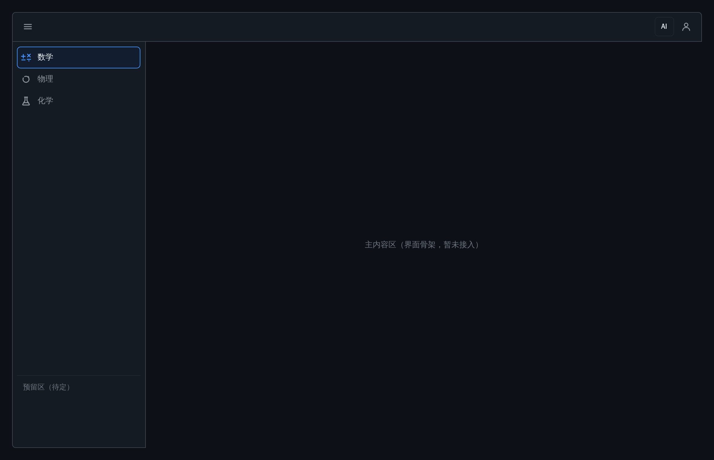
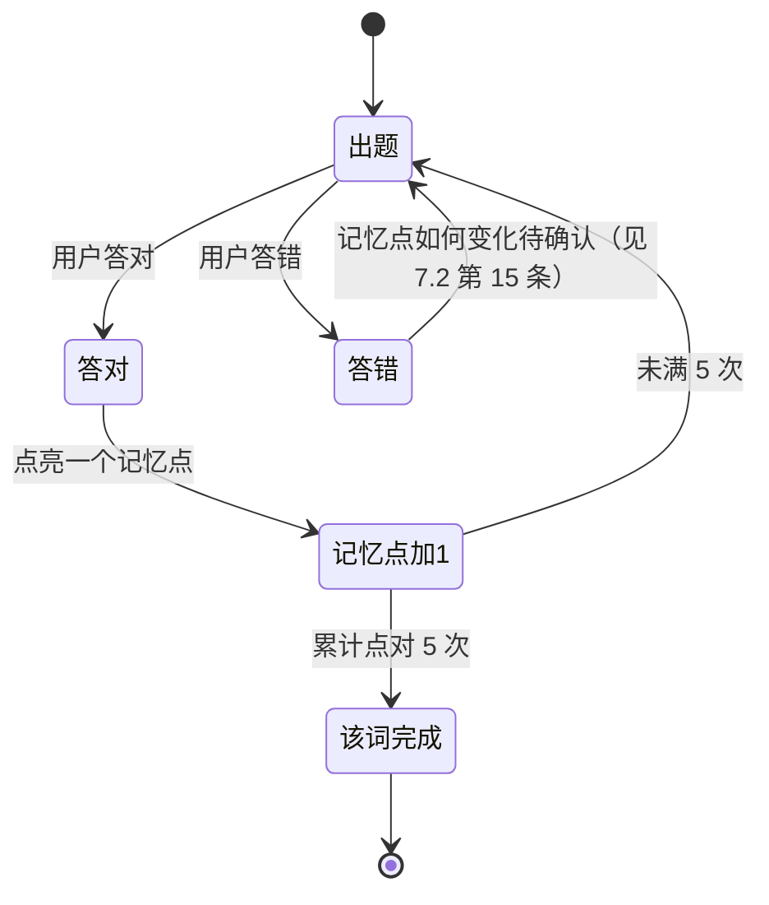
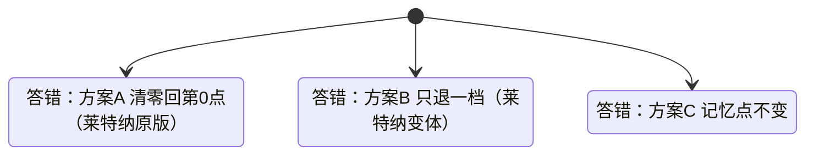
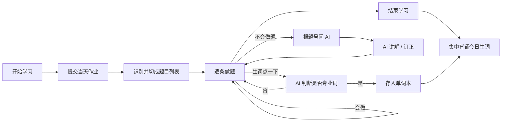

# 设计文档：学习助手软件的主页面（页面设计 + 骨架）

> 状态：**页面骨架已落地**（`src/ui/qml/Main.qml`），但**没有任何业务功能**：
> 不读文件、不解析文档、不调 AI、不保存 API Key。功能后续另开文档与任务。
>
> 本文是**当前作者的个人设计草案**。参考了 GitHub 的界面风格，但那只是本作者的偏好，
> **不构成仓库共识**，也不得被写成 `AGENTS.md` / `.github/copilot-instructions.md` 里的强制规则；
> 其他成员按自己的风格设计，互不约束（见第 2 节）。
>
> **设置项收件箱**：凡是「这个功能该放进设置里」的想法，一律先记到**第 8 节**，
> 不要散落在正文各处。设置页面还不存在，等它建好后整节迁过去，正文只留一句指向。

---

## 1. 产品定位（背景，不是本阶段的交付物）

一个帮助人学习的软件：

- 可以把**任意学习资料**（文档、笔记、课件等）丢进去，统一存放、按学科归类。
- 用户**自己填写 API Key** 使用 AI；或使用将来由官方提供的服务端（服务端方案以后再定）。
- 现阶段**本地优先**，不依赖账号体系与云同步。

以上只是确定界面要为什么服务，本阶段**只画界面**，这些行为都不实现。

---

## 2. 风格声明（重要）

- 主页面布局参考 **GitHub**：左侧窄图标导航 + 主体内容卡片 + 面板内分栏。
- 这是**个人选择**，不是仓库规范：不同人设计风格不同，谁都不用默认照抄 GitHub。
- 因此本文件**只作为设计稿**存在，不合并进任何 agent 指令或全局约定，
  也不要求其他分支、其他成员遵循同一套视觉语言。
- 若将来要统一风格，需要单独提出来讨论并写成正式规范，不能由某个人「同步仓库后自动全库生效」。

---

## 3. 整体布局

**当前实现效果**（深色主题，2 倍分辨率）：



另外两套主题：[浅色](screenshots/main-light.png)、[星空](screenshots/main-star.png)。

结构：**窗口内只有一个内容卡片**，卡片内部分「学科侧栏 + 主内容区」。

```text
┌──────────────────────────────────────────────────────────────┐
│ ┌──────────────────────────────────────────────────────────┐ │
│ │  ☰ 更多选项                                      [ AI ]  │ │
│ │──────────────────────────────────────────────────────────│ │
│ │  ✚✕  数学   │                                            │ │
│ │  ○   物理   │                                            │ │
│ │  ⚗   化学   │            主内容区（留空）                  │ │
│ │     ⋮       │                                            │ │
│ │  可滚动      │                                            │ │
│ │─────────────│                                            │ │
│ │ 预留区（待定）│                                            │ │
│ └─────────────┴────────────────────────────────────────────┘ │
└──────────────────────────────────────────────────────────────┘
```

> **没有左侧全局图标栏。** 草图上最左那一列图标是白板工具自己的工具栏，不是本软件的设计（见 4.1）。

---

## 4. 各区域设计说明

### 4.1 全局图标栏（**已撤销 —— 误读草图**）

> **重要更正（2026-11-01，作者指出）**：手绘草图**最左边那一列图标是白板工具自己的工具栏**
> （搜索、画笔、形状、便签、加号、成员、齿轮……），**不属于本软件的设计**。
> 本文早期版本把它误当成软件的全局图标栏并实现了 `RailButton`，**已全部删除**。
>
> 作者的原话：*「你好好看一下我给你画的那张图」* —— 草图上真正的设计只有**中间那一个方框**。
>
> 因此本软件**没有**左侧全局图标栏。窗口内只有一个内容卡片，卡片内部分是
> 「学科侧栏 + 主内容区」，头部左「☰ 更多选项」、右「AI」。
> 若将来确实需要全局导航，必须由作者明确提出，**不得再次从草图的白板工具栏推断**。

### 4.2 内容卡片头部

- 卡片顶部一条通栏（与卡片同宽），左侧是 **☰ 更多选项**，右侧是一组图标按钮。
- 头部不参与滚动，始终可见。

**右端图标顺序（从左到右）：**

| 顺序 | 图标 | 含义 | 状态 |
| --- | --- | --- | --- |
| 最右 | 用户图标（单人剪影） | **账号入口** —— 登录不同账号，同步各自的资料 | 已实现 |
| 左一 | AI | 唤起 AI 的入口 | 已实现，位于用户图标左侧 |

> **2026-11-01 更正**：早期版本这里写「靠左是＋（新增学科）」。作者后来澄清，
> 头部右端只有 **AI + 用户** 两个图标，**＋ 不再是头部元素**（新增学科的入口另行确定，
> 见 7.2）。早期骨架里那个 ＋ 已移除。

**用户图标（最右，2026-11-01 作者补充要求）**

- 形制：**单人剪影**（头 + 肩），不是两个小人。
- 用途：**登录不同账号，同步各自的资料**。多个用户各登各的账号，数据跟着账号走，
  不跟这台机器走。
- 未定：点击后是弹出登录框还是进入账号页、登录后图标是否变成头像或用户名首字母（见 7.2）。
- **更多选项（☰）**：草图注明「更多选项」，用于收纳这个卡片层面的次级操作/菜单（具体条目待定）。
- **AI 图标（右）**：草图注释的意思是——

  > 这里放一个 AI 图标，将来点它就能对软件做任何操作：比如换学科、从网上下载资料等，
  > 都可以让 AI 帮我操作这个软件里的所有东西；这个图标可以在设置里换成别的样子。

  所以它在界面上的含义是**「唤起 AI 的入口」**，位置固定在头部右侧、显眼可点。
  图标外观**可由用户在设置中更换**（本阶段只预留位置与显隐，不做功能）。

### 4.3 学科侧栏（卡片内左侧）

- 位置：卡片内左列，宽度 220px，与主内容区之间用 1px 分隔线。
- **每一行 = 学科图标 + 学科名**。图标是**该学科的符号**，目的是让用户
  **不用读文字、直接看图就知道是哪个学科**（作者明确要求）。
- 已实现的图标（`src/ui/qml/SubjectGlyph.qml`）：

  | 学科 | 图标画的是什么 | 依据 |
  | --- | --- | --- |
  | 数学 `math` | `+` `−` `×` `÷` 四则运算符号 | 数学最通用的视觉符号 |
  | 物理 `phy` | 带箭头的圆环（运动 / 循环） | 运动学意象 |
  | 化学 `che` | 三角烧瓶 + 液面 | 实验器材 |
  | 单词 `word`（预留） | 带横线的卡片 | 词卡 |
  | 生物 `bio`（预留） | 叶子 | 生物学意象 |
  | 语言 `lang`（预留） | 对话气泡 | 语言交流 |

  新增学科只需在 `SubjectGlyph.qml` 里加一个分支，侧栏行自动生效。
- 选中态：浅蓝底 + 蓝色描边 + 左侧 2px 强调条 + 图标与文字变强调色（GitHub 的选中样式）。
- 溢出：草图明确写了「东西太多放不下，这里可以下滑/滚动」——**该列表独立滚动**，
  不带动主内容区一起滚。
- 学科数量是动态的，因此行高（36px）与列表高度都要按「可增可减」来设计。

### 4.4 主内容区（卡片内右侧）

- 占据卡片剩余全部空间，本阶段**刻意留空**。
- 用途：展示所选学科下的资料/文档内容。**具体形态（纯列表 / 纯阅读 / 列表+阅读并置 / 空态引导）尚未确认**，
  作者表示会另行口述，本文件暂不记录猜测。
- 设计要求：留白足够，可容纳长文档滚动；不要在这块区域预先堆装饰，避免以后改版返工。

**学科专属功能（已确认的方向）**

- 不同学科点进去后，主内容区展示的**不只是资料**，还可能挂**该学科专属的功能**。
- 作者举例：如果有一个「单词」学科，点进去应当有「**背单词**」这个功能（一个背单词模块 / 页面）。
- 因此主内容区不是「一个固定的通用视图」，而是**按学科渲染不同内容**：学科可以有零个、一个或多个专属功能。
- **两个入口（已确认）**：
  1. **学科内入口**——点进某个学科后，可以只背**这一个学科**的单词。
  2. **全局入口**——右侧主内容区里有一个「背单词」按钮，点进去背**全部**单词（不限学科）。
  这两个入口是并列存在的，不是二选一。
- **词源有两个**（见 4.4.3）：① 用户自己导入/建立的词表；② 做题时点出来的生词，经 AI 判断为学科专业词后存入单词本。
  「背全部词」= 背单词本里的全部词，「学科内背单词」= 只背该学科相关的词。
- 仍待确认（见 7.2 第 12–14 条）：学科配置里功能是写死还是可配置、通用资料区与专属功能如何共存、
  全局「背单词」按钮的具体位置与外观。

#### 4.4.1 背单词模块（功能草案，界面细节未定）

> 这一节是**功能行为**，比主页面骨架更靠后；先记录以免丢失，不表示本阶段要实现。

**记忆逻辑参考对象：有道背单词的「BREAKI 记忆法」**

作者要求记忆逻辑参考有道背单词。已查证的公开资料（来源见本节末）：

- 有道官方宣传其 BREAKI 记忆法 = **艾宾浩斯记忆曲线 + Leitner System（莱特纳）的「五盒理论」**，
  把单词按**熟悉程度划分为 5 个等级**（对应 5 个盒子/5 个记忆点）。
- 这正是作者所说「每个词有 5 个记忆点、点对 5 次才算过掉」的出处：**5 = Leitner 的 5 个盒子**。
- 莱特纳五盒的标准规则（Wikipedia 描述的通则）：
  - 答对 → 升到**下一个盒子**，该盒间隔更长，复习频率更低；
  - 答错 → 退回**第一个盒子**（另有「只退一盒」的变体）；
  - 一般只有**最高一盒**答对才算「已掌握 / 退役」，其余按各自的时间间隔循环复习。
- 有道词典单词本的复习行为（旧版资料）：卡片下方两个按钮「不记得 / 我记得」，
  选「我记得」该词通过，选「不记得」则该词在后面**不定时再次出现**，直到「记得」为止；全部记得后本轮复习结束。

**本项目的机制（作者口述 + 参考上述模型）**

- 背单词分为**两个部分**：**学习**与**复习**。
- 每个词有 **5 个记忆点**，需要**点对 5 次**才算把这个词过掉。
- 结合参考模型，可以理解为「5 个记忆点 = 5 个熟悉度等级」，答对升一级、满级算掌握。

**尚未确认、不得自行补全的部分**（见 7.2 第 15–16 条）

- 答错时记忆点是**清零回到第 0 点**（莱特纳原版）、**只退一档**（莱特纳变体），还是**不变**。
- 每次考什么（拼写 / 选释义 / 听写 / 跟读），「学习」与「复习」各自考什么、先后顺序。
- 复习是否按**时间间隔**排程（艾宾浩斯的部分）：是按天提醒，还是一次会话内连续考 5 遍即可。

**参考来源**（2026-11-01 查阅）

- 有道背单词「BREAKI 记忆法 = 艾宾浩斯 + Leitner 五盒理论，按熟悉度分 5 个等级」——站长之家 2017-06-16 报道、简书产品分析；
  有道背单词官网也用了同一句表述。
- 有道词典单词本「不记得 / 我记得」曲线记忆复习流程——卡饭网教程。
- 莱特纳系统「答对进下一盒、答错回第一盒」通则——Wikipedia `Leitner system`。

#### 4.4.2 作业与学习闭环（功能草案，界面细节未定）

> 同样是**功能行为**，比页面骨架靠后；先记录，不表示本阶段要实现。

**核心主张（作者口述）**

- 每个学科里，用户都可以**提交当天的作业**。
- 遇到不会的题，**直接报题号**问 AI（例：「第 7 题不会」），不需要复制题干。
- 目标是把「晚上写作业」这件事的**整套流程**都收进软件里：
  从**开始学习** → 做作业 → 卡住提问 → 订正 → **结束学习**，
  **全程不跳出软件、不切到别的 AI**。

**这条主张的定位**

- 这是产品的**核心体验承诺**（"一站式"），比背单词更宽，属于**总目标**层面的设计原则。
  后续任何功能都要能放进这条流程里，否则就算破坏体验。
- 与第 1 节「本地优先 / 用户自填 API Key」一致：AI 在软件内部被调用，用户不需要另开网页。

**作者口述的方向**

| 环节 | 说明 | 状态 |
| --- | --- | --- |
| 提交当天作业 | 学科内提交作业（图片？文本？文件？未说清） | 方向已确认，形式待定 |
| 报题号提问 | 不会的题用**题号**指代，AI 据此定位并讲解 | 方向已确认，依赖「作业如何被识别」 |
| 学习会话 | 有明确的**开始学习 / 结束学习**两个端点 | 已确认存在这两个端点 |
| 全程不跳出 | 所有交互都在本软件内完成 | 已确认，视为硬性体验要求 |

**明显的依赖与风险（只记录，不解决）**

- 「报题号」要成立，软件必须知道**作业里第 7 题在哪**——这要求作业被解析成「题」的结构
  （拍照 OCR / 文档解析 / 手动录题），属于重功能，远超当前页面骨架阶段。
- 学习会话的「开始 / 结束」意味着要有**计时或会话状态**（可能还有专注时长统计），未讨论。
- 与 AI 的交互会消耗用户自己的 API Key，费用提示、失败重试、无 Key 时的降级都未讨论。

**题目按列表切分（作者口述，已确认方向）**

- 做题时，题目要**像列表一样一条条分开**显示，不是整张卷子一张图。
- 软件/AI 需要**把题目识别出来**（切题），每题独立成项。
- 因此「报题号」有了落点：题号 = 列表里的第几项。这条同时回应了 7.2 第 20 条的方向，
  但「识别准确率不够时怎么办」仍未定。

#### 4.4.3 生词收集与单词本联动（功能草案，界面细节未定）

**作者口述的流程**

1. 做题/读题时遇到**不会的单词，直接点它**。
2. **AI 判断这个词该不该收录**——判据是它**是不是学科专业词**（专业词才值得进单词本，
   通用词不占位置）。
3. AI 决定后，把该词**记进单词本**。
4. **作业完成之后**，再集中去**背诵**这些收集到的词。

**由此确定的架构含义**

- 单词本不是「只属于单词学科」的独立东西，而是**全局收集箱**：从作业里点出来的词会进这里。
- 与第 4.4.1 节/C10 的「背全部词」入口正好对上：全局背单词 = 背单词本里的词，
  学科内背单词 = 只背该学科的词。
- 所以「背单词」同时有**两个词源**：① 用户自己导入/建立的词表；② 作业中点出来的生词（AI 筛选后入库）。

**未确定的部分（见 7.2 第 23–25 条）**

- AI 判「是否专业词」时，用户能不能**否决**（点错了想撤回 / AI 判错想手动加）。
- 收录的词要不要**分区**（本科目 / 全学科通用），因为它关系到「学科内背单词」取哪些词。
- 「完成作业之后背诵」是自动弹出背诵，还是只给一个提示、由用户自己点。


### 4.5 侧栏底部预留区

- 草图在学科列表下方另画了一个矩形区块，与学科列表之间有一条横线分隔。
- 含义**尚未确定**，候选：文件/资料树、标签或收藏、当前学科的说明区。
- 本阶段只保留位置与分隔线，**不写任何内容**，等产品思路清楚再定。

### 4.6 明暗双模式（已确认为硬性要求）

- 界面**必须同时支持深色与浅色两种模式**，两者结构、间距、圆角、层次完全一致，只换配色。
- 目标平台风格参照 **macOS / 苹果** 的明暗外观：低饱和、边框克制、不做强对比色块。
- **已实现**（T-014）：配色不再是写死常量。`src/ui/theme.h/.cpp` 里有一张主题表，
  QML 只读 `Theme.palette.bg` 这类键名，**不认识具体是哪套主题**。
  启动参数 `--theme dark|light|star` 可指定；三套主题都已渲染验证。
- 切换方式**待确认**（自动跟随系统外观 / 手动切换 / 两者都支持），见 7.2 第 8 条；
  界面里的切换入口要等设置页面（T-015）。
- **主题不止两套**：除深 / 浅之外已内置一套「星空」（`star`）作为第三套示例；
  具体条目集中在**第 8 节设置项收件箱**（S1、S2）。

---

## 5. 视觉与尺寸要点（设计稿参数，非最终值）

| 项 | 建议 | 说明 |
| --- | --- | --- |
| 全局图标栏宽 | 48–56px | 与 GitHub / VS Code 的活动栏接近 |
| 学科侧栏宽 | 200–240px | 可拖拽调宽属于后续增强 |
| 卡片外边距 | 16–24px | 卡片与窗口之间留呼吸感 |
| 卡片圆角 | 6–8px | 与 GitHub 卡片接近 |
| 分隔线 | 1px，低对比 | 只做层次提示，不抢视觉 |
| 网格 | 8px 基准 | 间距、内边距取 8 的倍数 |
| 主题 | **深色 + 浅色双主题** | **硬性要求**，不是可选加分项；结构一致，只换配色 |
| 风格参照 | macOS / 苹果的明暗外观 | 低饱和、边框克制；与第 2 节的 GitHub 偏好不冲突，二者都只属于作者个人审美 |
| 字体 | 系统字体优先 | 中英文混排不塌陷 |

---

## 6. 本阶段明确不做的事

- 不实现任何功能：不读文件、不解析文档、不调用 AI、不保存 API Key。
- 不接服务端，不做登录、同步、分享。
- 不写业务代码，不出最终配色与图标资源。
- 不把 GitHub 风格写进仓库规则，也不要求其他成员参考它。

---

## 7. 已确认与待确认

### 7.1 已确认

| # | 结论 | 来源 |
| --- | --- | --- |
| C1 | 新增学科的入口**不在**侧栏；早期以为在头部右端（＋），2026-11-01 已更正为**不在头部**，位置另行确定 | 作者口述（已更正） |
| C2 | 卡片头部右端最右侧是**用户图标**（单人剪影），用途是**登录不同账号并同步各自资料** | 作者口述 |
| C3 | 头部右端**从左到右**是「AI → 用户」两个图标，用户固定在最右 | 作者口述 |
| C4 | **必须适配明暗两种模式**（对应苹果 macOS 的深色/浅色外观），这是硬性要求而非可选项 | 作者口述 |
| C5 | 主题是**多套**的：深 / 浅之外还要内置额外主题（如「星空」），在设置里选择 | 作者口述 |
| C6 | 主题要**开放扩展接口**，新增主题不需要改界面结构代码 | 作者口述 |
| C7 | 上述设置项先集中在第 8 节记录，等设置页面建好后再迁过去 | 作者口述 |
| C8 | 学科可以拥有**专属功能模块**：如「单词」学科内含「背单词」功能 | 作者口述 |
| C9 | 主内容区按所选学科渲染不同内容，而不是一个固定通用视图 | 由 C8 推出，作者未明确反对 |
| C10 | 背单词有**两个入口并列**：① 学科内 → 只背该学科的词；② 主内容区的「背单词」按钮 → 背全部词 | 作者口述 |
| C11 | 背单词分**学习**与**复习**两部分 | 作者口述 |
| C12 | 复习机制：每词 5 个记忆点，需点对 5 次才算记住 | 作者口述 |
| C13 | 记忆逻辑**参考有道背单词**（其 BREAKI 记忆法 = 艾宾浩斯曲线 + 莱特纳五盒理论，熟悉度分 5 级） | 作者口述 + 2026-11-01 查证，见 4.4.1 |
| C14 | 每个学科内可以**提交当天作业** | 作者口述 |
| C15 | 不会的题**直接报题号**问 AI，不必复制题干 | 作者口述 |
| C16 | 学习有**开始 / 结束**两个端点，构成一次学习会话 | 作者口述 |
| C17 | **整晚写作业的流程全部在本软件内完成**，不跳转到其他 AI——这是核心体验承诺 | 作者口述 |
| C18 | 做题时题目**按列表逐条分开**，由软件/AI 识别切题 | 作者口述 |
| C19 | 遇到不会的单词**直接点该词**，由 AI 判断是否为学科专业词、决定是否收录 | 作者口述 |
| C20 | 收录的生词进**单词本**，**作业完成之后**再集中背诵 | 作者口述 |
| C21 | 卡片头部右端除 AI 外还有**用户图标**（单人剪影），用于**多账号登录、各自同步资料** | 作者口述（2026-11-01） |
| C22 | 数据**跟着账号走**，不跟机器走：不同人登不同账号就拿到各自的资料 | 由 C21 推出 |

### 7.2 待确认

1. 全局图标栏里那几支「笔」分别是笔记、标注、绘画，还是同一功能的多个入口？需要收敛成几个？
2. 侧栏底部预留区到底放什么（资料树 / 标签 / 说明），会不会与主内容区重复？
3. 学科是否能嵌套（如 math → 代数 / 几何）？若要嵌套，侧栏需要树形结构而非平铺列表。
4. 内容卡片是「单卡片」还是允许同时开多个（标签页式）？
5. 主题切换入口放在最左栏底部，还是设置里？AI 图标的外观替换也在设置里，二者是否合并为一个「外观」页。
6. 卡片头部右端三个图标（＋ / AI / 用户）的最终排列顺序：AI 是紧挨 ＋，还是紧挨用户，还是被移到别处？
7. 主内容区在选中学科后显示什么形态（列表 / 阅读 / 并置 / 空态引导）——作者将另行口述。
8. 明暗模式怎么切换：自动跟随系统外观（Qt 的 `ColorScheme`）、手动在设置里切换，还是两者都支持。
9. 浅色模式的配色取哪一套基准（macOS 浅色系统色，还是自定义低饱和灰白），是否需要完全对齐系统色值。
10. 「设置项收件箱」（第 8 节）里的 S1 主题清单要做几套、叫什么名字；S2 的主题接口是配置文件、主题文件目录，还是需要支持用户自己导入。
11. ~~学科专属功能在主内容区怎么呈现~~ **已答复**：学科内入口可只背该学科的词，主内容区另有一个「背单词」按钮背全部词，两者并列（见 C10）。该按钮的**位置与外观**仍待定，见第 14 条。
12. 学科专属功能是**内置写死**（每种学科类型固定自带哪些功能），还是**每个学科实例可自由配置**（用户给某个学科加功能）。
13. 资料区与专属功能是否共存于同一学科——**作者答复：还没想好**，暂不定，实现时不要把结构锁死。
14. 主内容区的全局「背单词」按钮放在哪：学科标题下方的工具条、卡片右上的浮动按钮，还是资料列表顶部的一条横幅。
15. 复习答错时记忆点怎么走：**清零回第 0 点**（莱特纳原版）、**只退一档**（莱特纳变体）、还是**不变**。这直接决定 7.3 流程图里那条「待确认」的分支。
16. 复习时每道题考什么（拼写 / 选释义 / 听写 / 跟读），「学习」环节和「复习」环节各自出什么题、先后顺序如何。
17. 复习排程要不要照抄艾宾浩斯的时间间隔（按天/按小时提醒），还是一次会话内把 5 个记忆点连考完就行——有道是「按时间提醒 + 不记得就再出现」，本项目要不要这么重。
18. 是否要求 5 个记忆点**必须全部打满**才允许把词标记为「已掌握」；满级之后是否还要周期性回访（有道/莱特纳的「退役盒」也有回访）。
19. 作业以什么形式提交：拍照/截图、扫描 PDF、Word/图片文件，还是纯文本粘贴。这决定了「报题号」能否实现。
20. 「报第 7 题」时软件怎么知道第 7 题在哪——**方向已定：题目切成列表、逐条编号**（见 C18）；剩余问题是切题识别不准（手写、多栏、图文混排）时怎么补救，允许手动纠正吗。
21. 学习会话的「开始 / 结束」是纯计时（专注时长统计）、还是同时锁定一个作业清单？中途退出算不算结束。
22. 整晚流程里，除了做作业和提问，还要不要包含「订正 / 错题归档 / 明日计划」这些收尾环节。
23. 点词后 AI 判「是否学科专业词」——用户能否**否决/撤销**（AI 判错时手动加、判对时手动删）。
24. 收录的生词是**只归当前学科**还是**全局共用**；学科内背单词时取哪些词由此决定。
25. 「作业完成后背诵」是**自动进入背诵**，还是只提示一句、由用户自己点进去。
26. 点用户图标后是什么形态：**弹出登录框**、进入**账号页**，还是显示一个下拉菜单（登录/退出/切换账号）。
27. 登录后用户图标是否要变：显示**头像图片**、**用户名首字母**，还是保持剪影不变。
28. 同步怎么做：走官方服务端（作者说「服务端后面再说」）、还是先用**本地多用户 profile**、
    或者用户自己填同步地址（如 WebDAV / 自建服务）。
29. 同步的范围：只同步配置与词表，还是**连导入的资料文件一起同步**（后者涉及容量与隐私）。
30. 未登录时软件能否使用？能的话数据放本地、登录后再合并，还是强制先登录。
31. 新增学科的入口到底放哪（原以为是头部 ＋，2026-11-01 已否定）：侧栏底部、☰ 菜单里，还是学科列表末尾一行。

以上问题定下来之前，不要动手写界面代码。

---

## 7.3 附：复习流程示意（作者口述的机制，非界面稿）

> 只画机制，不代表最终交互，也不表示本阶段要实现。



参考有道 / 莱特纳后，答错分支的**三种候选**（未定）：



### 7.4 附：整晚学习流程（作者口述的目标，未定稿）



图中「订正 / 错题归档」尚未确认是否属于流程（见 7.2 第 22 条）。

---

## 8. 设置项收件箱（等设置页面建好后迁入）

> 设置页面目前**不存在**。这里先集中记录「该放进设置里」的想法，避免散落丢失。
> 设置页面建好后，整节迁到独立的设计文档（如 `docs/design-settings.md`），本文只留一句指向。

### 8.1 主题 / 外观

| # | 设置项 | 内容 | 状态 |
| --- | --- | --- | --- |
| S1 | **主题选择** | 除黑 / 白（深色 / 浅色）两套基础主题外，内置若干**额外的主题**，例如「星空」等 | 已确认要做，具体内置哪些主题待定 |
| S2 | **主题接口对外开放** | 主题不能写死成两套常量，要留出**可扩展的主题接口**，让以后能新增主题（自定义或第三方）而不改界面代码 | 已确认要做，接口形态待定 |
| S3 | AI 图标外观替换 | 头部 AI 按钮的图标样式可换 | 原问题 5 遗留，待确认 |
| S4 | 明暗模式切换方式 | 跟随系统 / 手动 / 两者都支持 | 见 7.2 第 8 条 |

补充说明：

- S1 的「星空」是作者举例，**不代表已定稿的内置主题清单**；数量与命名都待确认。
- **已实现**（T-014）：主题由 `src/ui/theme.cpp` 的 `kThemes` 表驱动，新增主题只需
  在该表里加一份 `Palette`，QML 与界面结构代码都不用动——这就是 S2 要的「接口」。
  当前内置 `dark` / `light` / `star`，新增方案的具体形态（配置文件 / 主题目录 / 插件）
  仍可在实现阶段细化，但「不改结构代码」这条已由当前实现保证。
- 主题扩展与第 2 节的风格声明不冲突：**主题是个人偏好，同样不得写成仓库全局规则**。

